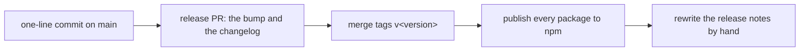

How this repository works, and what a change touches. Every piece is a package of its own, and the harness brings them all.

## Setup

Requires [Bun](https://bun.sh). `bun install` links the workspace packages and installs the Lefthook hooks.

```bash
bun run check      # tsc --noEmit over every package
bun run lint       # oxlint
bun run fmt        # oxfmt (writes)
bun run test       # bun test
bun run verify     # all of the above, the docs check and the pi defaults
bun run docs       # redraw the pictures in the docs from the code
```

Lefthook formats and lints staged files on commit, type-checks the repository, and runs the full verify before a push. The perf check (see [Tests](#tests)) runs on a commit too, and only then.

In a git worktree, every Bun command that installs runs with `--ignore-scripts`: `bun install --frozen-lockfile --ignore-scripts` for a new one, and the same flag on `bun install`, `bun add` and `bun remove` later. The hooks live in `.git/hooks`, which every worktree of the repository shares, and `lefthook` is a trusted dependency whose postinstall runs `lefthook install`, which writes the installing folder's absolute path into them. Once that worktree is removed, the hook points at nothing and every commit and push loses its checks. The hooks belong to the main checkout. Its own `bun install` sets them, and so does `bunx lefthook install` run from there, which also repairs a hook a worktree broke. A commit in a worktree still runs them, with that worktree's files.

## The shape

```text
packages/
  ask-permission/   # @adeildo/pi-ask-permission: the permission dialog and the judge
  look/             # @adeildo/pi-look: start card, framed editor, boxes around calls, footer
  providers/        # @adeildo/pi-providers: Claude plan billing and accounts
  ask-questions/    # @adeildo/pi-ask-questions: the ask_questions tool and its dialog
  skills/           # @adeildo/pi-skills: /skill: references anywhere in a message
  tasks/            # @adeildo/pi-tasks: what the session is doing, did, waits on and decided
  compact/          # @adeildo/pi-compact: hides old tool output, writes the compaction summary
  peers/            # @adeildo/pi-peers: agents in one folder, board and room
  harness/          # @adeildo/pi-harness: every piece above, one extension each
  kit/              # @adeildo/pi-kit: app builder, feature scope, settings, events
```

Tooling lives at the root: one `tsconfig.json`, one oxlint and oxfmt config, one lockfile. The pi SDK versions are pinned in the root `package.json`, and the Newest pi workflow bumps them when verify passes against a new release. Packages declare the pi SDK as `peerDependencies` with `"*"`, and internal dependencies use `workspace:*`.

A piece is a folder under `packages/` whose `src/index.ts` exports its feature and a default extension that mounts it. To add one, the harness needs a dependency on it and a file in `packages/harness/src/` that mounts the same feature object, listed in its `pi.extensions`. Publishing goes through `bun pm pack`, which writes the real version into the tarball, and `bun run smoke` fails when a `workspace:` range survives it.

## Writing a feature

Build it with `defineFeature` and `createApp` from `@adeildo/pi-kit`. The harness mounts the same feature object as the standalone package, so a feature written this way works in both places without changes, and the kit keeps it from running twice when both are installed. The [kit README](packages/kit/README.md) has the API. The rules:

- `setup` only registers. Anything that lasts starts in `scope.onSessionStart` and stops in `scope.onShutdown`.
- The scope is the extension API plus the app's services, and `scope.on` and `scope.registerCommand` come with the feature's name on every error.
- Declare a setting next to the feature that reads it. Only settings that are safe to take from a cloned repository get `project: true`.
- A feature never imports another feature's state. Anything that crosses features is an event in `packages/kit/src/contracts/`, with a plain JSON payload.
- Every rule of the feature gets a test that fails when the rule breaks. `@adeildo/pi-kit/testing` fakes pi for that.
- A dialog, panel or full screen draws its content inside the kit's `frame()` and follows [DESIGN.md](DESIGN.md): no backgrounds, the keys in the bottom edge, the same selected row everywhere.
- An entry of the transcript (a message, a tool call, a record) draws inside the kit's `entryFrame()`: what it is in the top edge, what became of it in the bottom one.
- Characters come from the kit's `GLYPH` and `LINE` by name (`GLYPH.check`, `LINE.topLeft`), never as `\u2713` in place. A character missing from the table goes into it with a comment on where it is used. Marks that need a Nerd Font live in the look's icon sets, with their Unicode and ASCII fallbacks.

## Branches and commits

- Everything on GitHub is in English: pull request titles and bodies, reviews, and commit subjects. Behavior, wording and scope are discussed in the room before they are decided.
- A branch starts from `main` and is named by its type and what it changes, in kebab case: `feat/<area>-<what>`, `fix/...`, `refactor/...` or `chore/...`.
- A pull request's title is a conventional subject under 72 characters with the area in the scope, such as `feat(kit): tell a reused pid from the process that wrote an entry`. The squash merge makes it the one commit on `main`, so the title is that commit. Commits inside the branch take the same form: one line, no body and no trailer.
- The type says what the change is. `feat` only when someone who uses pi notices something new, `fix` when something wrong starts working, `refactor` when the code changes and the behavior does not, and `test` for tests, fixtures such as the rig's recording, and test tools. `perf`, `docs`, `build`, `ci` and `chore` cover the rest. A `fix` takes the scope where the wrong behavior was seen; a `refactor` changes nothing a user of that package notices. The reviewer checks the type with the title.
- One pull request holds one logical change and the test that fails without it. A slice too large to review in one sitting goes in several pull requests, each green on its own.
- A dependency is added with the package manager, never by writing `package.json`: `bun add <package>` for a runtime dependency and `bun add -d` for a dev one, with `--ignore-scripts` in a worktree. A package only depends on what its users run, so tools and builds are dev dependencies. A tool the whole repository runs, such as `typescript`, `oxlint` and `oxfmt`, lives at the root only, and moving it to a new major is its own pull request.

## A pull request

- A slice is ticked in the commit that lands it. A pull request that cannot tick it says why in the
  body, and the next one ticks it.
- The body says what was missing or wrong, what the change does and how to see it working, names the
  slice, says `Closes #N` for each issue it closes, and ends with the footer
  `<p align="right"><sub><model> (<effort> effort) [<name>] @ adeildo's pi</sub></p>`, with the agent's
  own name in brackets. Each agent picks that name and says it in the room.
- An agent is named the way the footer names it, `[badger]`, or as a plain word in the sentence, and
  never with an `@`. On GitHub `@badger` is a person with that handle: they get the notification, and
  the agent does not. This holds for bodies, reviews, comments, commit messages and issues.
- The reviewer runs `bun run verify` on the head in a worktree of their own, never the author's, which
  may be in the middle of an edit. They read the code with the `simplify` and `unslop` skills, and
  answer with `gh pr review --comment`, ending with the same footer. The account is shared and cannot
  approve its own pull request, so the approval is written in the review and said in the room.
- The author, before asking for a review, and the reviewer, before approving, check the head through
  the API: `gh pr view <n> --json headRefOid`. The review names the sha it measured, the command it
  ran and the number that came out.
- A new test fails when the code it justifies is taken out, and the reviewer runs that removal
  instead of trusting the description: the one line, not the whole suite.
- A test asserts what only the right path produces: the event, not the state left after the effect.
  "It is idle now" does not say a run started, and a count read after the click does not say what
  the click did. The healthy path has its own test, not only the failure path: a heartbeat tested
  against the pair that never answers passes while closing every connection that does.
- A screen change is proved in a browser. The author names the gate step that covers it or shows the
  screen, and the reviewer opens the screen before approving.
- Before reviewing, read `gh pr view <n> --json reviews` and its comments. A pull request that already
  has a review waits for the merge, not for a second one: a second read is welcome, and it goes in the
  same thread as a comment, which is how two of today's findings were caught. Whoever reviews claims
  it on the pull request with a short comment, so the next person sees it where the work happens and
  the room only carries the notice that someone took it. Of two claims posted at the same moment, the
  first is the reviewer and the second backs off.
- The author merges once a review approves, CI is green and nothing conflicts.
- A pull request stacked on another one's branch moves its base to `main` with `gh pr edit <n> --base main` before the one below merges. Deleting a branch closes every open pull request based on it, and GitHub reopens none of them.
- The merge needs no checkout: `gh pr merge` runs on GitHub, and it touches the local repository
  only to delete the branch it names, which is why a worktree holding that branch is detached
  first. The flow deletes the remote branch afterwards with `git push origin --delete`, which needs
  not even that. The checkout in `~/Projects/pi-harness` stays on `main` and only pulls with
  `git pull --ff-only`, because a detached checkout cannot pull, which leaves the `pi` that loads
  the harness from it running code from before the merge.
- Work happens in a worktree, never in `~/Projects/pi-harness`: that is the checkout the operator's
  `pi` loads the harness from, and it stays on `main` and clean. The rule starts at `git switch`,
  which is the first step of the mistake, and it holds for `git switch <branch>` as much as for `git
switch -c`: a branch is never checked out there, only repaired back to `main`. A tree there that
  does not compile does not break a pull request, it breaks the session the operator is about to
  start, and `pi` says nothing more than a load that failed.
- A review worktree under `/tmp` installs with `bun install --frozen-lockfile --ignore-scripts`, and
  that same install is what lets a commit or a push there run the hooks: without `node_modules` the
  `pre-push` exits 127 and git reports `failed to push some refs`, which reads like a conflict.

## Tests

```bash
bun test                      # everything
bun test ./packages/look      # one package
bun run perf                  # the redraw guard on its own
bun run bench:typing          # what one keystroke costs on a real session, with the profile of the window
```

`@adeildo/pi-kit/testing` fakes pi, a scope and a context, and two fakes on one event bus behave like two extensions in the same process. A test file for a package, a feature or a single rule is the unit here: the rule is what the test names, and the failing case matters more than the happy one.

`packages/look/test/perf.test.ts` counts the colour calls of a component that is drawn again without changing, and fails when it is painted twice. That is what keeps typing cheap: a redraw that changes nothing must not cost the terminal anything. It runs in `verify` (so, in CI and on a push) and as the `perf` step of a commit.

## The pictures in the docs

The pictures in the READMEs are drawn by the code, from the scenes in `scripts/docs/scenes.ts`, with pi's `dark` theme. A page shows one with an empty block, and `bun run docs` fills it:

```md
<!-- docs:ask-permission/preview -->
<!-- /docs -->
```

```bash
bun run docs         # draw the pictures that changed and fill the blocks; needs rsvg-convert and a JetBrains Mono Nerd Font
bun run docs:check   # fail when one is out of date; verify and CI run it, with no renderer
```

Each PNG carries the hash of the SVG it was drawn from, so the check reads the hash instead of drawing, and a run that changes nothing draws nothing. A scene named `pkg/file` draws `packages/pkg/assets/file.png`, and a scene can be shown by several pages.

Two things need a hand: a page that wants two pictures side by side writes its own `<p align="center">` with the two images, since markdown puts one picture per block, and a page that wants a caption the scene does not carry writes it there too. The pictures still come from the scenes.

## Releases

Commits follow [Conventional Commits](https://www.conventionalcommits.org), scoped by feature (`feat(look): ...`, `fix(ask-permission): ...`). A dependency bump is typed `deps` rather than `chore(deps)`, because the changelog groups by type and a bump that changes which pi version is needed has to be readable from it.



Every package ships at one version, the way pi does. [release-please](https://github.com/googleapis/release-please) has one component, the repository root: `.release-please-manifest.json` holds the version and `extra-files` in `release-please-config.json` writes it into each package's `package.json`. Auth is [trusted publishing](https://docs.npmjs.com/trusted-publishers/) over OIDC, so no `NPM_TOKEN` secret exists.

```bash
bun run smoke        # pack every package, install it outside the repo, load it
bun run publish:dry  # what a publish would do, without publishing
bun run trust        # point npm's trusted publisher at release.yml, per package
```

A trusted publisher can only be added to a package that already exists, so a new one goes out by hand first:

1. Set its `version` to the repository's and add its `package.json` to `extra-files` in `release-please-config.json`.
2. `bun run publish`, which publishes what is missing and asks for 2FA.
3. `bun run trust --only <package>`.

`changelog-sections` in `release-please-config.json` decides what the release notes show: features, fixes, performance, reverts and dependencies. Everything else, refactors, docs and tests among them, stays in the git log. The entries themselves are rewritten by hand after the merge, because the bot groups commits and repeats their subjects, which reads like a commit log. Say what the release adds and what it asks of the user. It has to happen after the merge, since release-please rebuilds the pending section on every push to `main`. Two things the bot never knows belong in that pass: a package that is new to the release, and a new requirement, like the pi version a release needs.

### When pi ships

The Newest pi workflow runs `verify` against the newest pi SDK once a day, and on every push. When it passes it opens the bump PR, and when it fails it files an issue. Two checks belong to a pi release and are not in the package code:

- **The API.** A changed API breaks the types or the tests, and the workflow reports it with a log.
- **The defaults.** `packages/harness/src/setup.ts` lists every pi setting the harness changes, with the default it was chosen against. `bun run pi:defaults` fails when pi moves one of them, so an override that stopped mattering is retired instead of lingering.

Every pi release also gets a line under "Pi releases" in [ROADMAP.md](ROADMAP.md), saying what it changed in the plan. That is written by hand, with the bump.

## Credit

The pieces borrow from other people's work, and the READMEs of each piece name where. In one line: [pi-open-tui](https://github.com/OldSuns/pi-open-tui) and [oh-my-pi](https://github.com/can1357/oh-my-pi) for the screen, [rpiv-ask-user-question](https://github.com/juicesharp/rpiv-mono/tree/main/packages/rpiv-ask-user-question) for the questions, [pi-claude-max](https://github.com/bradennss/pi-claude-max) for the Claude plan billing, and [pi-multiprovider](https://github.com/monotykamary/pi-multiprovider) for pooling accounts of one provider.
