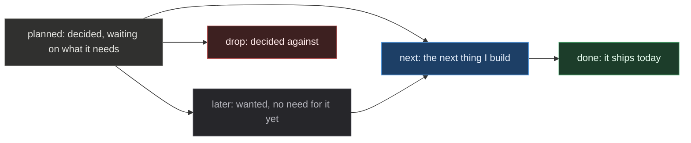
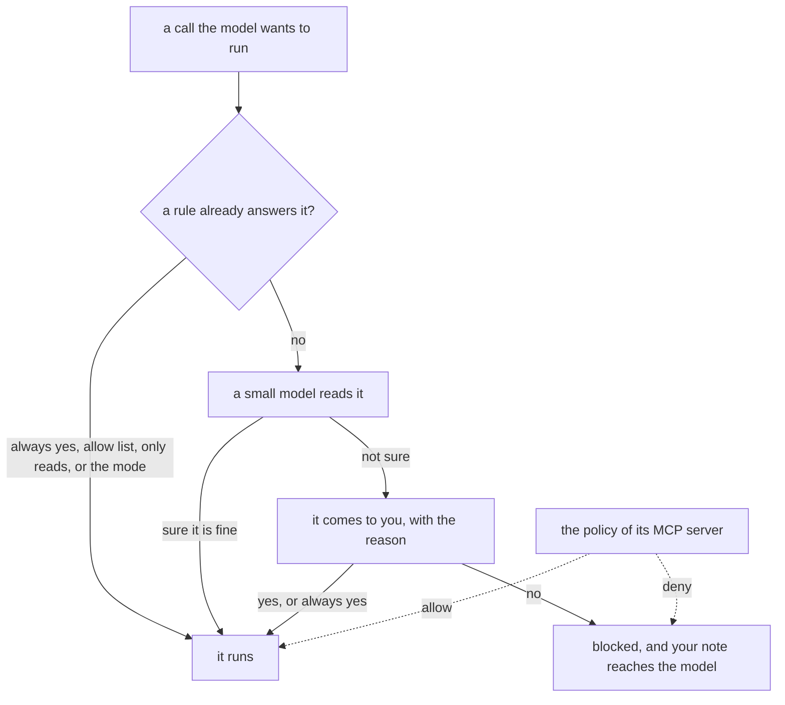

## Where this is going

The agent writes faster than I read, and that will not change soon. So the work is not to take me out of the loop. It is to make my decision arrive in time, with less of my attention spent per call.

The destination is one install where several agents work at once and I stay the one who decides. Every call that matters reaches me with what I need to judge it, on the call itself. Every session says what it is doing, what it costs and what it decided, in a form the next session can read. And I can answer from my phone, under the same policy.

An item earns its place by saving something I do ten times a day, and it says how much. If the reason is that it is more elegant, it goes.

## Rules for every item

- Pi first. Before an item starts, check that pi does not ship it. Every pi release gets a pass over this file, logged at the end.
- Pi stays Pi. No fork, and `pi remove` puts it back.
- Every feature is built on `@adeildo/pi-kit`, and features only talk through the contracts in `packages/kit/src/contracts/`. The payloads are plain JSON, so a bridge can forward them without knowing what they mean.
- Anything that decides for me is visible and can be undone.
- Nothing leaves the machine unless I ask. That covers usage, traces and memory.

An item moves from `planned` to `next` to `done`, and leaves by `drop`. The notes stay short on purpose: `CHANGELOG.md` has the detail of what shipped.

This is how a call is decided today. Everything in the picture ships.

## Permission. `@adeildo/pi-ask-permission`

| Item                        | Status | Note                                                                                                               |
| --------------------------- | ------ | ------------------------------------------------------------------------------------------------------------------ |
| The dialog                  | done   | yes, always yes or no, with a note the model reads, on a command longer than three lines shows how many are left   |
| Grants at three scopes      | done   | session, project and everywhere, forgotten from the settings screen                                                |
| Modes                       | done   | manual, edits, judge and full, with `Alt+W` for a call outside the workspace                                       |
| MCP policies and codemode   | done   | a call follows the policy of its server, and every call inside a script is decided on its own                      |
| The judge on pi's models    | done   | `ctx.modelRegistry.classify()`, so there is no provider of ours and no prompt of ours to keep                      |
| Every call says who decided | done   | the reason sits on the call, and the calls of one answer are judged together                                       |
| Judge reads the tasks       | done   | the session and what it is doing, from my words only, beside my last message, and the ruling says when it saw them |

## Questions. `@adeildo/pi-ask-questions`

| Item                       | Status  | Note                                                                           |
| -------------------------- | ------- | ------------------------------------------------------------------------------ |
| The tool and its dialog    | done    | options, a preview of each, a note on any of them, and a row for my own answer |
| One dialog for both        | done    | the permission ask goes through it, so both take the same keys                 |
| `ctrl+g` in a typed answer | planned | opens the external editor, the last piece of the port                          |

## Tasks. `@adeildo/pi-board`

It replaced `@adeildo/pi-goal`. In a week of sessions, the goal timeline left most finished work in `later`. A message sent while the agent worked had pushed 72 of the 87 items there aside, and the end of the run could only close the one step under way.

| Item                     | Status | Note                                                                                                                                                     |
| ------------------------ | ------ | -------------------------------------------------------------------------------------------------------------------------------------------------------- |
| Six states               | done   | doing (several at once), queued, waiting on me or on something outside, deferred, done with its result, and dropped                                      |
| Decisions                | done   | the choices I made or the agent reported, kept apart so a later reader does not undo them                                                                |
| Asks while it works      | done   | they queue instead of pushing the task under way aside, and the end of the run settles each one it worked on                                             |
| A change needs its words | done   | a close cites the line that reports the work, a wait the line that asks, a new task your words, a decision what it beat                                  |
| Only my words are intent | done   | the judge reads the title and what is under way from my words only. The model never sees what a tool returned, except my answers in the questions dialog |
| `Alt+T`                  | done   | the tasks by state over the chat, the result beside each done one, and keys that put the selected one under way, close, defer or drop it                 |
| Measured                 | done   | `bun run tasks:eval` with cases from real sessions, 97 to 99% on Claude Haiku, and a replay of any recorded session                                      |
| Closed by the agent      | later  | a tool the agent calls to close a task with its result, with the end of the run as the fallback when it forgets                                          |

## Context. `@adeildo/pi-compact`

Hiding old tool output works as well as summarizing it and costs less ([JetBrains, NeurIPS 2025](https://arxiv.org/abs/2508.21433)), so the rules are plain code and a model only writes pi's summary.

| Item                      | Status | Note                                                                                                                                                                                                                                                                            |
| ------------------------- | ------ | ------------------------------------------------------------------------------------------------------------------------------------------------------------------------------------------------------------------------------------------------------------------------------- |
| Hide old tool output      | done   | past 150k tokens when a run ends, so the cache rewrite lands on my next message, and mid-run only past 80% of the window. Outside the last 10 turns, in batches that free two fifths or more. At least 32% less on a week of sessions, counting all of the context as rewritten |
| Clear on Anthropic's side | done   | `clear_tool_uses` in place of the prune, keeping the agent's thinking. Off by default: on 744 requests of Opus 5.5 each clear rewrote the whole prompt to free 5 to 30% of it, about $2 a clear                                                                                 |
| Copies of a pruned call   | done   | a call that copies the prune's note, or a value cut short, does not run, so the agent does not learn to cut its own                                                                                                                                                             |
| The prune's line          | done   | in the chat, with the most the cache rewrite costs and in how many requests it pays back                                                                                                                                                                                        |
| Summary from the tasks    | done   | pi's prompt on the side model, with the tasks and my words on top. As good as pi on Opus on 48 probes, at 1/40 of the price                                                                                                                                                     |
| Re-read share             | done   | each hidden call the agent runs again is counted on the Compact tab. 1 of 181 in the first live prune                                                                                                                                                                           |
| Jev keeps exceptions      | later  | only if the re-read share passes ~10%. A model picking what stays cost 94% more in [OpenHands' study](https://arxiv.org/abs/2605.18854)                                                                                                                                         |

Open:

- The re-read count matches a call by its name and the start of its target, so two inline scripts with the same first line count as one. Fine while the share stays low.

## Accounts. `@adeildo/pi-providers`

| Item                 | Status  | Note                                                                                                                                                                                                        |
| -------------------- | ------- | ----------------------------------------------------------------------------------------------------------------------------------------------------------------------------------------------------------- |
| Subscription         | done    | an Anthropic OAuth request is billed to the Claude plan, and an API key goes out untouched                                                                                                                  |
| Several accounts     | done    | every credential of a provider with accounts is a named account, `/accounts` manages them and `Alt+A` switches                                                                                              |
| Switch on limit      | done    | an account that hits a limit hands over to the next one, asking first by default                                                                                                                            |
| Cache between runs   | done    | pi's idle refreshes go out while the chance you come back, learned from a month of sessions, pays for them. About 23 minutes on Opus 5.5                                                                    |
| Cache misses         | done    | the Providers tab lists each request that wrote the cache again, what it cost over reading it, and why: a pause, a prune or a server clear, a compaction, a new model, a changed system prompt or tool list |
| Claude Code pin      | done    | the version Pi reports is pinned, and a cron reverse engineers each Claude Code release and opens the bump pull request                                                                                     |
| Compatible endpoints | done    | an OpenAI-compatible endpoint is added from `/login` with a name, a URL and a key, and its chat models come from its `GET /models`. No `models.json` to write by hand                                       |
| Quota per plan       | next    | what is left and when it resets, read from the endpoints below. A feature of its own, because three items read it                                                                                           |
| Account by quota     | planned | the switch moves to the account with the most left, instead of the next in the list. Needs the quota                                                                                                        |
| Quota on the look    | planned | a segment in the footer, in percent and reset time. Needs the quota                                                                                                                                         |

The quota endpoints are not official, and each needs the token pi already stores.

| Provider   | Endpoint                                                                     | Gives                                 |
| ---------- | ---------------------------------------------------------------------------- | ------------------------------------- |
| Anthropic  | `api.anthropic.com/api/oauth/usage`, with `anthropic-beta: oauth-2025-04-20` | 5-hour and weekly windows, and resets |
| OpenAI     | `chatgpt.com/backend-api/wham/usage`, with `ChatGPT-Account-Id`              | Windows with percent used             |
| Copilot    | `api.github.com/copilot_internal/user`                                       | Percent left, allowance, reset, plan  |
| OpenRouter | `openrouter.ai/api/v1/key`                                                   | Credit used, limit and what is left   |

The Anthropic side is researched in [`packages/providers/docs/quota.md`](packages/providers/docs/quota.md): the three sources, the headers, the traps, and the prior art.

Sign in with ChatGPT lives on the `openai` provider now, and `openai-codex` is legacy, so the OpenAI quota reads whichever one holds the token. A third-party tool on a Claude plan spends extra usage billed per token, not the plan's windows, so the Anthropic windows show what Claude Code used.

The 5-hour window is a block, not a rolling window: it opens with the first message sent after the last one reset, and resets 5 hours later. So the reset time is fixed from that first message, and an account with no message since its reset has no window open yet.

## What I see. `@adeildo/pi-look`

| Item                     | Status | Note                                                                                                                                                                                                                                              |
| ------------------------ | ------ | ------------------------------------------------------------------------------------------------------------------------------------------------------------------------------------------------------------------------------------------------- |
| The start card           | done   | the π, the folder and the model, and under them only what changed or waits on me since my last session there: a sign-in, a conflict, a branch behind, a failed CI run, a pull request with changes requested, other agents, a new harness version |
| The framed editor        | done   | the branch, the folder, the permission mode, the model and the context in its borders                                                                                                                                                             |
| The strip and the footer | done   | the stopwatch, the last call's wait and speed, then the cost, the tokens, the cache and the average speeds                                                                                                                                        |
| A box around each call   | done   | the icon, the name, the reason it ran, a cut before the output, and the time on the bottom line. An `edit` or `write` shows its end while the model writes it, and my messages and pi's own entries wear the same frame                           |
| The output of a call     | done   | `Alt+O` opens one call's whole output to scroll, newest first, the arrows moving between calls                                                                                                                                                    |
| Settings with a preview  | done   | `Alt+S` keeps three choices, the icons, the editor's frame and my messages' frame, each drawn as I pick it                                                                                                                                        |

Open:

- Some of the pi settings the harness sets are already pi's defaults now. `bun run pi:defaults` checks that on every run, and `packages/harness/src/setup.ts` holds the list.

## Usage

| Item         | Status  | Needs         | Note                                                                                                                                                      |
| ------------ | ------- | ------------- | --------------------------------------------------------------------------------------------------------------------------------------------------------- |
| Usage ledger | planned |               | One record per session, project, account and model, built from `~/.pi/agent/sessions` with a cache. Time worked is a heuristic                            |
| `/usage`     | planned | Quota, ledger | One screen with what the plan says is left next to what I spent, per account. Dollars where the provider bills per token, percent where it bills per plan |

Open:

- How long a gap counts as a pause when the ledger measures time worked? Fifteen minutes is the guess.

## Sessions

| Item                       | Status  | Needs         | Note                                                                                                                                                                                                                                                                                                                                                                                                                        |
| -------------------------- | ------- | ------------- | --------------------------------------------------------------------------------------------------------------------------------------------------------------------------------------------------------------------------------------------------------------------------------------------------------------------------------------------------------------------------------------------------------------------------- |
| Session naming             | done    | Session state | `pi-tasks` names the session after its title, while you have not named it with `/name`                                                                                                                                                                                                                                                                                                                                      |
| Session state              | done    |               | `pi-tasks` keeps what is doing, done, waiting and decided, and `currentTasks()` hands it to other features                                                                                                                                                                                                                                                                                                                  |
| Files and the last summary | planned | Session state | what a session touched, live, and a summary of the run that just ended: the two pieces of the session state `pi-tasks` does not keep                                                                                                                                                                                                                                                                                        |
| Memory                     | planned | Session state | Replaces `pi-memory`. Markdown is the source of truth, and a command reviews and deletes what was stored                                                                                                                                                                                                                                                                                                                    |
| `/btw`                     | planned |               | A side question while the agent works, as in [Claude Code](https://code.claude.com/docs/en/commands). It goes to the same model with the conversation so far, so it reads the cached prefix instead of paying for it again, and the agent's run never sees it. The answer stays in the chat as a line the model does not read, where Claude Code's [throws it away](https://github.com/anthropics/claude-code/issues/65878) |
| Mentions                   | later   |               | `#entry`, `@file` and session references expanded before the turn                                                                                                                                                                                                                                                                                                                                                           |

Open:

- The design is not settled. `pi-memory` does the job well today, so a replacement has to beat it at something specific before it starts.
- One memory file with sections, or a global one and one per project?

## Many sessions, one policy

| Item                      | Status  | Needs                | Note                                                                                                                                                                                                                                                                                                                                                                                                                                                                                                                                                                               |
| ------------------------- | ------- | -------------------- | ---------------------------------------------------------------------------------------------------------------------------------------------------------------------------------------------------------------------------------------------------------------------------------------------------------------------------------------------------------------------------------------------------------------------------------------------------------------------------------------------------------------------------------------------------------------------------------- |
| Event log                 | done    |                      | `pi-kit` writes typed, versioned events: on `pi.events` inside the process, and as one JSONL per session on disk that only that session writes. Each event names its session and pi entry. Peers, the bridge and the web UI read the same files, so the web UI replays what happened instead of guessing it                                                                                                                                                                                                                                                                        |
| Sessions talking          | done    | Event log            | `@adeildo/pi-peers`, files only, no broker. The board and the room are projections of the folder's event logs: each live session publishes its tasks and what it edited and ran, the room carries the talk, a mention wakes an idle agent and waits for a busy one's run to end, `urgent` steers, a message to everyone reaches every session, and every session works out the same winner of a request to anyone. A peer's request becomes a task from that peer, which the judge never reads. And the agent is told who else is here, with what they are doing, when they arrive |
| Destination on the editor | planned | Peers                | a message that mentions `@name` or `@everyone` shows where it goes on the editor's frame, the way the room's own composer draws it                                                                                                                                                                                                                                                                                                                                                                                                                                                 |
| Peers, redesigned         | planned | The shared ground    | Agents write to each other by mail; a setting lets them wake each other when idle, or also cut in, with the chain limits only then. Writing to an idle agent shows its board line first and sends on `send: true`. `@anyone` and its bids go, shared rooms become lists of sessions (folder members turn into their open sessions), a color comes from the handle, and the footer's `@N`, which counted the folder's whole history, goes. See [`docs/remote.md`](docs/remote.md#what-peers-keeps-changes-and-drops)                                                                |
| Conflict guard            | planned | Peers                | an edit to a file a live peer just touched, or `git add -A` while one has changes, goes to the judge with that peer's name                                                                                                                                                                                                                                                                                                                                                                                                                                                         |
| Rooms across folders      | done    | Peers                | A shared room is a directory of logs like a folder's, and a session can be in several. Folders and sessions are members; `Alt+G` lists the rooms on the left, with the open one's conversation on the right, and changes them from the list. How it works is in the [peers README](packages/peers/README.md)                                                                                                                                                                                                                                                                       |
| An agent asks for a room  | done    | Rooms across folders | `peers` with `link` brings the sessions open in another folder; the permission mode decides, or a setting keeps it to me. `pi-ask-permission` gains `alwaysAsks` on the tool adapter                                                                                                                                                                                                                                                                                                                                                                                               |
| Subagents                 | later   |                      | Replaces `pi-subagents`. Children over `RpcClient`, with their permission dialogs forwarded to the parent, on the parent's account                                                                                                                                                                                                                                                                                                                                                                                                                                                 |
| The routed model          | later   | A router             | With a virtual model, the look shows the model that answered instead of `auto`                                                                                                                                                                                                                                                                                                                                                                                                                                                                                                     |

## The outside world

| Item                  | Status | Replaces        | Note                                                                                                                  |
| --------------------- | ------ | --------------- | --------------------------------------------------------------------------------------------------------------------- |
| Web search and fetch  | later  | `pi-web-access` | Route by kind of question: docs, code or news                                                                         |
| GitHub, Linear and CI | later  |                 | CI as a watcher that emits events, and a policy per repository                                                        |
| QA in a browser       | later  |                 | Reuse a session I already signed into, and never see a password. Open: attach over CDP, or a profile I sign into once |

## From anywhere

The design is in [`docs/remote.md`](docs/remote.md): the pieces, where state lives, machines and naming, sync, offline, the protocol, peers and remote together, reach and login, the gaps in pi, and the prior art. The phases below are its phases, and [`docs/remote-plan.md`](docs/remote-plan.md) splits them into slices of work with an owner each.

| Item                | Status  | Needs               | Note                                                                                                                                                                                                                                                                                                                |
| ------------------- | ------- | ------------------- | ------------------------------------------------------------------------------------------------------------------------------------------------------------------------------------------------------------------------------------------------------------------------------------------------------------------- |
| The shared ground   | planned | Event log           | F0. Presence with pid, start time and lease, session state, `by`, the protected list, and names drawn from a list of animals with renames and aliases, all in the kit. Every question of the harness through `harness:ask`. Peers reads presence and names from the kit. Change events, new log types, the protocol |
| Read only           | planned | The shared ground   | F1. A bridge in every pi and a daemon per machine, on loopback, with a login even there. The web app shows every session live, synced by cursors and cached                                                                                                                                                         |
| Control             | planned | Read only           | F2. The inbox, which holds follow-ups until the run settles. Prompts, steering, abort, model, answers to every dialog with the first answer winning, the offline outbox, presence                                                                                                                                   |
| Reach and login     | planned | Control             | F3. Tailscale, a bound interface, Cloudflare Access or a reverse proxy, with sealed payloads where a third party ends the TLS, and device pairing, a password or API keys. Push when a session needs you and you are active nowhere                                                                                 |
| Background sessions | planned | Reach and login     | F4. `pi-remote run` holds `pi --mode rpc` in a unit of its own or under any supervisor. Any pi takes a session back as a view, mid-run. The Background setting installs a user service                                                                                                                              |
| Machines            | planned | Background sessions | F5. Machines link by pairing, each side granting the other `view`, `control` or `start`, and a client sees the machines linked to its daemon. Shared rooms span linked machines, and a device's home pushes for all of them. Offline machines show when they were last seen                                         |
| Native apps         | later   | Reach and login     | F6. The same Expo codebase as the web app, built for iOS and Android, with QR pairing and native push                                                                                                                                                                                                               |
| Voice               | later   |                     | Local whisper, with the text pasted into the editor                                                                                                                                                                                                                                                                 |

A client or a linked machine never sets the permission mode to `full`, never grants an "always yes" that outlives the session, and never changes the Remote settings.

## Platform

| Item                       | Status | Note                                                                                                                                                      |
| -------------------------- | ------ | --------------------------------------------------------------------------------------------------------------------------------------------------------- |
| The pi defaults check      | done   | `bun run pi:defaults` fails when pi moves a default a harness setting was chosen against                                                                  |
| One frame for every dialog | done   | `pi-kit` owns the frame, the keys on its edge, the pointer and the rule (`packages/kit/src/ui/frame.ts`), with `DESIGN.md`; every dialog draws through it |
| The typing bench           | done   | `bun run bench:typing` measures what one keystroke costs on a real session, with the profile of the window                                                |
| `/harness setup`           | next   | Applies the pi settings listed in `packages/harness/src/setup.ts`, which a package cannot set by itself                                                   |
| A release preflight        | next   | Refuses to release when `main` is behind, the tree is dirty, or CI is red for the commit                                                                  |
| A local release dry run    | next   | Installs the packed tarballs outside the repository and runs a real `pi` session against them                                                             |

## Waiting on pi

- **Hiding a provider from `/model`.** `enabledModels` covers startup and cycling only, and a command cannot shadow a built-in. `pi-hide-providers` stays until pi has a catalog hook.

## Parked

- A policy that learns from my denials. It needs a decision log and months of it, and it would only ever suggest.
- Review with anchored annotations. It needs the session state.
- A sandbox that decides where a command runs. Whether it may run is the permission's question, where it runs is another.

## Out

- Semantic PR review, which is a product of its own.
- A fork of pi, a plugin store, vector search in the first memory, a policy that changes by itself.
- Translations. English only.

## Pi releases

What each pi release changed in this plan.

- **1.2.0 (2026-10-12).** `before_agent_start` became a union on `messageType` and now also fires for runs started by `pi.sendMessage(..., { triggerTurn: true })`. The ask-questions handler only adds tool guidelines, so it applies to those runs as well and needed no change. A run counts as busy from the moment it starts and `sendUserMessage` requires `deliverAs` while busy, so `pi-peers` always passes it instead of asking `isIdle()` first. `serializeConversation()` no longer sends thinking blocks, which only moves the compact eval's baseline. The experimental server, client and plugin stack and the `chord` dependency are gone, and the configuration schemas moved to `pi.dev/schemas`; nothing here used them. The editor stopped drawing its own reverse-video cursor, so the three pictures were regenerated.
- **1.1.0 (2026-10-07).** Terminals and dashboards see when pi waits on a dialog (OSC 7501), which the remote bridge can use to notice an approval waiting. `agent_settled` says when a run was cancelled.
- **1.0.2 to 1.0.4 (2026-10-04 and 05).** Nothing for this plan.
- **1.0.1 (2026-10-03).** Extensions call classifiers through `ctx.modelRegistry.classify()`, and Cloudflare's Clef joins Jev. The judge runs on them, and its own TypeSafe client and the chat model path came out. `.pi/mcp.json` can switch a user's MCP server for one project, which the MCP policy reads as any other server.
- **1.0.0 (2026-10-01).** Fullscreen is the default `tuiMode`.
- **0.99.2 (2026-09-30).** `/reload` turns on tools newly added to `defaultTools`, so `/harness setup` can add a tool without a restart.
- **0.99.1 (2026-09-29).** Nothing for this plan.
- **0.99.0 (2026-09-29).** MCP is built in, with codemode, `tool_search` and `/mcp`, so the MCP item became the permission for MCP calls. The `system` theme is the default, so the desktop theme goes. Virtual models route requests, so the model per task is a router and not code of mine. Sign in with ChatGPT moved to `openai`, and the quota follows the token. `pi config` filters every package's extensions, which took the feature switches off `/harness setup`.
