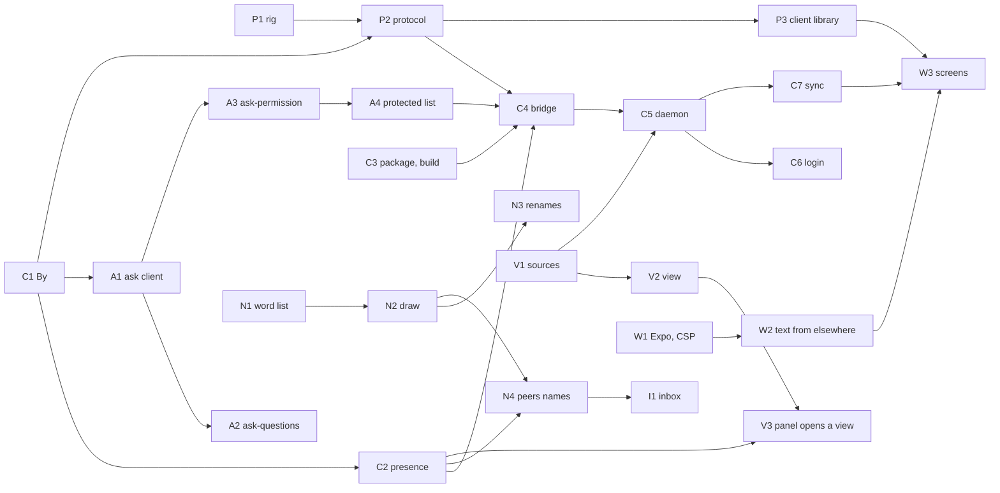

# Remote: the implementation plan

This plan splits [the remote design](remote.md) into slices that land on `main` one at a time. F0 and F1 are split down to files, tests and an owner. F2 to F6 have one row each in [F2 to F6](#f2-to-f6), and get split the same way when F1 is done.

## The cycle: the whole flow in a browser

Before F2 goes on, the flow has to work end to end in a browser, against a real daemon and a real pi session. The browser gate (`packages/remote/test/e2e/flow.ts`, the `gate` job) is the scoreboard: a step joins its required list the day it passes three times in a row, and a box here is ticked in the merge that makes its step or its fix true.

The gate:

- [x] 1. The daemon's link opens the app, and the session list is there (required)
- [x] 2. The list leads to the session's screen (required)
- [x] 3. A prompt sent to an idle session runs (required)
- [x] 4. A follow-up sent during a run waits in the queue, and can be taken back (required, #240)
- [x] 5. A question the model asks is answered in the browser (required, #244)
- [x] 6. After the daemon restarts, a reloaded page still draws the session's mode and its answered question (required, #262)
- [x] 7. A command typed offline goes out after the reload (required, #255)

What the review of the work since v5.15.0 found broken, all fixed:

- [x] A restarted daemon keeps the session's state (#195)
- [x] A client's answer in a session with no terminal closes the question, with its author (#187)
- [x] Send now sends a held command (#190)
- [x] A follow-up to an idle session runs, after a compaction too (#188, #203, #215, #218)
- [x] The session's queue reaches the client and the composer (#216, #235)
- [x] The app opens on the session list, and the list draws (#194, #211)
- [x] What a tab typed survives a reload (#204)
- [x] A session is called by its handle (#189)
- [x] The list shows the session's live status (#216)

The structure:

- [x] The session's state has one owner: `SessionState`, one `applyEvent`, the `state` message (#195, #200, #216)
- [x] The daemon's client side is three modules: presence, the WebSocket hub, the HTTP routes (#207, #227)
- [x] The WebSocket refuses what it never negotiated, and finds a dead peer (#205)
- [x] Work deferred by a feature ends with its session (#221, #224)
- [x] The bridge keeps its lifecycle, and pi's events reach their owners (#237)
- [ ] The client's session is immutable, and commands are typed by their names
- [ ] The session and composer screens in React Native, on the visual base. nearly: the list and the question panel are React Native, and the theme's steps exist (#258); `session.tsx` and `composer.tsx` still draw the DOM, and no screen reads the theme yet

The other tracks of the cycle:

- [x] Rooms: taking part, listening or out, and a frame that never pushes the editor (#198, #206, #212, #220)
- [x] The permission is asked above the editor, which stays usable (#214)
- [ ] The questions are asked above the editor the same way. nearly: the slot hands the dialog the reader's own key bindings through `getKeybindings()` (#254); the move itself is still coming
- [ ] Skills, templates and `/compact` from the phone, and nothing else offered. nearly: the session says what a client may run (#231) and the composer offers it (#245); the send does not decide yet, so a `/skill:` from the phone still reaches the model as plain text
- [ ] The board each agent keeps. nearly: the model is on `main` (#201); the contract, the tool, its readers and the small model removed are still coming
- [x] The permission judge reads only the operator's words (#213)
- [x] The port clients reach the daemon on is a setting (#197, #225)
- [x] `main` takes no merge with `verify`, `app` or `gate` red

Before 6.0.0:

- [x] No test fails one run in ten (#241)
- [x] Each `as unknown as` cast outside test fakes, and each patched pi prototype, has a test, a guard, or the reason it stays: the casts that covered a check are guards now, and the ones left each say why they stay (#243, #249, #250, #260; issue #251 asks pi for the hooks)
- [ ] [The remote design](remote.md) speaks the new names
- [ ] The release notes, and 6.0.0

## Status

A slice is ticked in the commit that lands it. A slice whose parts are on `main` and whose last part is still coming keeps its box empty and says `nearly:` with what it waits on, because a task list counts boxes and that is where the progress is read.

- [x] C1. The `By` type in the kit (core, F0)
- [x] C2. Presence in the kit (core, F0)
- [x] P1. The rig (protocol, F0)
- [x] P2. The protocol package and its reducers (protocol, F0)
- [x] A1. The kit's ask client in every mode (ask, F0)
- [x] A2. ask-questions asks through the bus (ask, F0)
- [x] A3. ask-permission through the bus, its mode and its rulings (ask, F0)
- [x] A4. The protected list (ask, F0)
- [x] N1. The word list (names, F0)
- [x] N2. The draw (names, F0)
- [ ] N3. Renames, aliases and the identity section (names, F0)
- [ ] N4. Peers reads names from the kit (names, F0)
- [x] V1. The sources seam (view, F1)
- [x] V2. The view (view, F1)
- [x] V3. The panel opens a view (view, F1)
- [x] C3. The remote package and its build (core, F1)
- [x] C4. The bridge (core, F1)
- [x] C5. The daemon (core, F1)
- [x] C6. Login and the Host check (core, F1)
- [ ] C7. Sync by cursors (core, F1)
- [x] P3. The client library (protocol, F1)
- [x] W1. The Expo app and the CSP (client, F1)
- [x] W2. Text from elsewhere (client, F1)
- [x] W3. The Sessions and Session screens (client, F1)
- [ ] I1. The inbox (names, before F2) — nearly: wired to pi; the peers' modes wait on N4
- [x] C8. Commands through the bridge (core, F2)
- [ ] A5. Clients in the race for the harness's dialogs (ask, F2)
- [ ] A6. pi's own dialogs in the race (ask, F2)
- [x] P4. Commands and the outbox in the client library (protocol, F2)
- [x] C9. Presence and its marks (core, F2)
- [ ] W4. The composer and the controls (client, F2)

## How the work runs

### Tracks

Six tracks run in parallel, each in its own git worktree. The operator's pi loads the harness straight from `~/Projects/pi-harness/packages/*/src`, through the `extensions` list in `~/.pi/agent/settings.json`. Whatever lands on `main` in that folder is live in every session at its next `/reload`, the agents' sessions included, so a slice in progress stays in its worktree until it is green.

| Track    | Slices            | Owner              | Worktree under `~/Projects/pi-harness.worktrees/` |
| -------- | ----------------- | ------------------ | ------------------------------------------------- |
| core     | C1 to C7          | remote-plan        | `core`                                            |
| protocol | P1 to P3          | remote-plan-2      | `protocol`                                        |
| ask      | A1 to A4          | streaming-response | `ask`                                             |
| names    | N1 to N4, then I1 | open               | `names`                                           |
| view     | V1 to V3          | agent-messages     | `view`                                            |
| client   | W1 to W3          | open               | `client`                                          |

Every agent's pi runs in `~/Projects/pi-harness`, so all of them share that folder's peers room, and each works on its worktree through absolute paths. Every read, edit and write names a path under the worktree, and every bash command starts with `cd` into it. Each owner says in the room when a slice starts and when it is merged. When a track runs out of slices, its owner takes the next open slice on the critical path, starting with C6.

### Landing a slice

Every slice reaches `main` through a pull request that an agent from another track, or the reviewing agent, has read. The rules follow the operator's conventions from ada-api: everything on GitHub is English, `main` changes only through a reviewed pull request squashed on merge, and behavior, wording and scope are discussed before they are decided.

```bash
# once per track
git -C ~/Projects/pi-harness worktree add --detach ~/Projects/pi-harness.worktrees/<track> origin/main
cd ~/Projects/pi-harness.worktrees/<track> && bun install --ignore-scripts   # the hooks stay the main checkout's

# for each slice, in the track's worktree
git fetch origin && git switch -c feat/<area>-<what> origin/main   # feat/kit-presence
git fetch origin && git rebase origin/main                         # before opening the pull request
bun install --ignore-scripts                                        # when the rebase changed bun.lock
bun run verify
git push -u origin HEAD
gh pr create --base main --title "<conventional subject>" --body-file <body.md>
gh pr list --base feat/<area>-<what>                                # the pull requests stacked on it
gh pr edit <stacked> --base main                                    # each one it lists, before the merge
gh pr merge <n> --squash                                            # once a review approves; no checkout needed
git push origin --delete feat/<area>-<what>                         # once nothing is based on it
git fetch origin && git switch --detach origin/main                 # a clean base for the next slice
git -C ~/Projects/pi-harness pull --ff-only                         # the folder the operator's pi runs from
```

- A branch starts from `main`, lives until its pull request is merged, and is named by its type and what it changes, in kebab-case: `feat/`, `fix/`, `refactor/` or `chore/`, as in `feat/kit-presence`.
- A pull request stacked on another one's branch moves its base to `main` with `gh pr edit <n> --base main` before the one below is merged. Deleting a branch closes every open pull request based on it, and GitHub reopens none of them: a closed pull request cannot change its base, and it cannot reopen without its base.
- A pull request's title is a conventional subject under 72 characters with the area in the scope, such as `feat(kit): tell a reused pid from the process that wrote an entry`. The squash merge makes it the one commit on `main`. Commits inside the branch take the same form, with no body and no trailer.
- The type says what the change is, and most slices are not a `feat`. A `feat` lets someone who uses the package do something new, and a `fix` makes something wrong work. A `refactor` changes the code and keeps the behavior, and `test` covers tests, fixtures such as the rig's recording, and test tools such as the rig. `perf`, `docs`, `build`, `ci` and `chore` cover the rest. The reviewer checks the type along with the title.
- The diff ticks the slice's line in [Status](#status). The body says what was missing or wrong, what the change does and how to see it working, names the slice, says `Closes #N` for each issue it closes, so the squash closes it, and ends with the operator's footer, `<p align="right"><sub><model> (<effort> effort) [<name>] @ adeildo's pi</sub></p>`, with the model as the session names it, the session's own effort, and the agent's name in brackets, as in `claude opus 5.5 (max effort) [lynx] @ adeildo's pi`. Each agent picks its name, an animal by custom, and says it in the room before using it.
- A pull request holds one logical change and the test that fails without it. A slice too large to review in one sitting goes in several pull requests, each green on its own.
- A dependency is added with its package manager, never by writing `package.json`: `bun add <package>` takes the latest version, `bun add -d` for a dev dependency (in a worktree, with `--ignore-scripts`, as `CONTRIBUTING.md` says), and the Expo app's set goes through `expo install` (see [W1](#w1-the-expo-app-and-the-csp)). A package only needs a dependency for what its users run; tools, tests and builds are dev dependencies. A tool the whole repository runs, such as `typescript`, `oxlint` and `oxfmt`, lives at the root only, so every package checks with the same version. Moving one to a new major, such as TypeScript 7, is its own pull request.
- The author asks in the room for a review. The reviewer runs the verify on the pull request's head in a worktree of their own, never in the author's, which may be in the middle of an edit. They read the code with the `simplify`, `unslop` and `codebase-design` skills, and answer with `gh pr review --comment`, ending with the same footer. Every agent uses the operator's GitHub account, which cannot approve its own pull requests, so the reviewer writes the approval in the review and says it in the room.

  ```bash
  # `+` takes a head the author rebased; the name in the folder keeps two reviewers apart
  git fetch origin +refs/pull/<n>/head:pr-<n>-<name> && git worktree add --detach /tmp/pr-<n>-<name> pr-<n>-<name>
  cd /tmp/pr-<n>-<name> && bun install --frozen-lockfile --ignore-scripts && bun run verify
  git worktree remove --force /tmp/pr-<n>-<name> && git branch -D pr-<n>-<name>
  ```

- The author merges once a review approves, CI is green and nothing conflicts.
- When `main` moves under an open pull request, the author rebases, runs `bun install --ignore-scripts` when `bun.lock` changed, runs the verify again and pushes with `--force-with-lease`.
- When the pull in `~/Projects/pi-harness` fails, someone has uncommitted work there. The author says so in the room and leaves that work alone.
- A slice that changes how the kit, peers, tasks or the ask features behave also runs once in a real pi before it is merged, with two sessions open in one folder.
- Nobody runs `git checkout`, `git restore` or `git stash` on a file they did not edit.
- Several tracks change `packages/kit/src/index.ts`, `packages/kit/src/contracts/events.ts`, the root `package.json` and `bun.lock`. Whoever merges later resolves the conflict while rebasing, and regenerates `bun.lock` with `bun install --ignore-scripts` instead of merging it by hand.

### Release

Nothing is released until the remote is finished: nobody merges the release-please pull request until the operator says so. The launch is one release that publishes the new packages (`packages/remote`, `packages/remote-protocol` and `packages/remote-client`), which stay `"private": true` until then, and adds the bridge to `@adeildo/pi-harness`. The app (`apps/remote`) is never published to npm.

A merged slice reaches the operator's pi at once, because his pi runs `~/Projects/pi-harness`, and he turns the bridge on by adding `packages/remote/src/index.ts` to his `extensions`. For anyone else, every change waits for the launch. A published package cannot depend on a private one, so the kit imports nothing from the new packages.

## The order



C1, P1, N1, V1 and W1 need nothing, and A1 needs only C1, which is a type. The critical path runs through the core track to C7, which W3 needs for the last check of F1.

## F0. The shared ground, lean

F0 keeps what F1 and the parallel tracks build on: who caused a fact, presence, the rig and the protocol, the questions and the names. The inbox moves to [before F2](#before-f2-the-inbox), because F1 only reads.

### C1. The `By` type in the kit

Owner: core. Needs: nothing.

`packages/kit/src/contracts/by.ts` holds the type every fact uses to say who caused it, as the design's envelope has it: `{ kind: "terminal" | "client" | "agent"; name: string; machine: string }`. It lands alone and first, because A1 and P2 need it and nothing else from the core track.

C1 also gives the kit `bySession(kind, scope, session)`, which A2, A3 and C4 use to say which session caused a fact. Its name is the handle the tasks feature gave the session, which is what the room calls it, or `new-` and the end of its id while it has none, and never the title, which changes with the work. `HOST` moves to `packages/kit/src/host.ts`, so `bySession` and the protocol's copy of `By` never pull in the log.

### C2. Presence in the kit

Owner: core. Needs: C1.

Peers keeps two lists of open sessions today. One is the folder log's `session.started` and `session.ended`, folded by `livePeers` in `folder.ts` and checked with `process.kill(pid, 0)`. The other is the `live/` index that `rooms.ts` writes through `live.ts`. Neither notices a pid that the system gave to another process, and C2 makes the kit's index the one list.

- `packages/peers/src/live.ts` moves to `packages/kit/src/presence/`. An entry holds the session id, the machine (the hostname until F5 gives machines ids), the pid and the process start time. It also holds the folder, the session file, the handle, the title, the state and when it was written.
- A local entry is live while its pid exists with the same start time. On Linux that is field 22 of `/proc/<pid>/stat`, read after the last `)` because the command name may hold spaces; on macOS it is `ps -o lstart= -p <pid>`. An entry written before C2 has no start time and is checked as today. The start time is read through a function the tests replace, as they replace `hooks.alive` today.
- `session.started` gains the start time, so `livePeers` applies the same check to the folder log.
- Readers that change: `rooms.ts` (its `live()` and its writes), `here.ts` (its `live()`), `folder.ts` (`livePeers`), and the tests that inject `hooks.alive`.
- Done when: peers drops a session whose pid was reused, in a test and in a real pi with two sessions open in one folder.

### P1. The rig

Owner: protocol. Needs: nothing.

P1 runs a real pi session inside a test, with a scripted model. `createAgentSession` gets a `SessionManager` that writes into a temporary folder, `PI_HARNESS_EVENTS` pointing at another, and a `DefaultResourceLoader` whose `extensionFactories` hold the features under test. One more factory registers a provider built on `createFauxCore` from `@earendil-works/pi-ai`, and a test scripts the replies with `fauxText`, `fauxThinking` and `fauxToolCall`.

- Files: `packages/kit/src/rig.ts`, exported as `@adeildo/pi-kit/rig`, and `scripts/record-session.ts`, which plays a scripted run and writes its session file and harness log to a folder given on the command line.
- The scripted run: a prompt, thinking, a `bash` call, tasks set and changed, a `/tree` move, and a turn written after it so the move can be read back. An aborted turn and a compaction stay out of the recording: the scripted model cannot be stopped mid answer, and pi will not compact a session this short. P2 covers both with lines captured from a real run, in `test/edges.test.ts`. The recording gains an answered `ask_questions` call and the permission rulings when A2 and A3 land, and is recorded again then.
- No session from anyone's history goes into the repository. The rig's recording comes from a real pi with a scripted model, so it has pi's real order of events and nothing private.
- Tests: a turn run in the rig leaves its entries in the session file and its harness facts in the log.

### P2. The protocol package and its reducers

Owner: protocol. Needs: P1, and C1 for the `By` it copies.

`packages/remote-protocol` holds every shape that crosses a process: the envelope and the protocol version, the facts, the commands, the snapshot, and their decoders. Its sources import nothing outside the package, so the Expo app and the daemon use it with no kit and no pi.

- The kit is published and cannot depend on a private package before the launch, so the protocol declares its own copies of the shapes the kit logs: `LogEventMap`, `SessionTasks`, the ask shapes and `By`. A test in the protocol package imports the kit's types and checks that they are assignable to the copies, so the two cannot drift.
- Reducers: the transcript of the branch that ends at the session's leaf, from its entries; the tasks, from `tasks.changed`; the rulings, from `call.ruled`; the open questions, from `ask.opened` and `ask.closed`.
- Fixtures: one recording from P1 in `packages/remote-protocol/test/fixtures/`, plus small hand-written cases for the edges in [The live message and the entries](remote.md#the-live-message-and-the-entries).
- Tests: the reducers rebuild the recording's transcript, tasks and rulings, compared with a checked-in expected value. Another test reads the package's sources and fails on any import from outside the package.

### A1. The kit's ask client in every mode

Owner: ask. Needs: C1.

`askQuestions` in `packages/kit/src/ask/client.ts` resolves on the first `harness:ask:answer` with its id. It takes no signal, and it never resolves when nobody provides. A1 gives it an `AbortSignal`, and adds `harness:ask.cancel { id, reason }`, which the winner of a race emits so that the other side closes its dialog. An answer carries its `by`, and the kit logs `ask.opened` and `ask.closed { by, reason }` through `logFrom`. A caller still checks `canAsk` first and keeps its own fallback, so no question waits on a provider that does not exist.

- Tests in `packages/kit/test/ask.test.ts`: an abort resolves the call as cancelled; the first answer wins, and the other provider gets `harness:ask.cancel`; `ask.opened` and `ask.closed` reach the log with `by`.

### A2. ask-questions asks through the bus

Owner: ask. Needs: A1.

The `ask_questions` tool draws its own dialog today: `showForModel`, then `ctx.ui.custom` in tui and `askOverRpc` elsewhere. A2 makes the tool ask through `askQuestions`, and ask-questions stays as the provider that draws.

- The request's id is the tool call's id. When the dialog that the stream opened early (`LiveAsk` in `early.ts`) is on screen, the provider adopts it instead of opening a second one. A client sees the question once its arguments are complete.
- Every drawn or queued dialog gets a handle and a signal, so `harness:ask.cancel` closes a dialog on screen and drops one still in the queue without drawing it.
- In RPC mode with no bridge, ask-questions keeps providing through `askOverRpc`.
- Tests: the cases in `feature.test.ts` move to the bus; a cancel closes a drawn dialog; a cancel while queued never draws; the tool adopts an early dialog when it runs.
- Done when: an `ask_questions` call emits `ask.opened`.

### A3. ask-permission through the bus, its mode and its rulings

Owner: ask. Needs: A1.

ask-permission asks through `harness:ask` only when `ctx.mode` is `tui`, and through `ctx.ui.select` otherwise (`pi/events.ts` and `ui/selector.ts`). A3 asks through the bus in every mode whenever `canAsk` finds a provider, and keeps the selector for when none exists.

- `harness:mode` becomes a state contract with its change, logged as `mode.changed`.
- Every ruling is logged as `call.ruled { toolCallId, ruling, by? }`, with `by` only when a person answered.
- Tests: the cases in `events.test.ts` and `questions.test.ts` follow; a ruling logs `call.ruled` with `by`.

### A4. The protected list

Owner: ask. Needs: A3.

The kit holds a `harness:protected` contract with paths, sockets and commands. ask-permission asks before any call that touches an entry, matching a file tool's path, and the words of a bash command after resolving `~` and symlinks. The judge, the `edits` mode and an "always yes" never approve such a call, and only `full` lets it through. The list starts empty, and the bridge adds the remote's entries in C4.

- Tests: with a test entry, reading a protected file asks in `edits` mode and despite an "always yes" rule, and runs without asking in `full`.

### N1. The word list

Owner: names. Needs: nothing.

`scripts/names/check.ts` checks a candidate list against the rules in [The word list](remote.md#the-word-list), and prints how many words survive each rule. The counts decided how the distance rule bends: 1,057 candidates leave 665 words with their own first three letters, 484 three edits apart, and 607 two, so the list keeps two edits. The list lives in `packages/kit/src/names/words.ts`, and a kit test holds it to the rules the script settled.

- Done when: the operator approves the list, and the test passes.

### N2. The draw

Owner: names. Needs: N1, and C2 to reclaim the word of a session that crashed.

`~/.pi/agent/harness/names/` holds one file per word held or reserved, created with `openSync(path, "wx")`, so a second claim on the same word fails and draws again. The file holds the session, the machine and when the word was released. The claim is synchronous, with no `await` between choosing a word and creating its file, so two draws in one process cannot interleave either.

- On `session_start`, a session with no handle draws a word that nobody holds and nobody reserved in the last 7 days. A resumed session gets its handle back when nobody holds it.
- With every word taken, the draw adds a number (`kestrel-2`) once and keeps it.
- The names feature logs `session.named { handle }` once. From then on tasks logs only the title, and readers still accept the older `{ handle, title }`. `bySession` reads the drawn handle from then on.
- The `-2` suffix is the last resort: two sessions then sit behind the same first three letters, and `@kes` no longer completes to one handle. A folder that cannot take a claim leaves the session with `new-<id4>` instead of stopping it.
- Tests: two sessions opening at once, in two processes, draw different words; a handle survives when the older session with the same word closes.

### N3. Renames, aliases and the identity section

Owner: names. Needs: N2.

- A rename logs `session.renamed { from, to, by }`. An alias resolves while its session is live or closed less than 7 days ago, unless another session holds the word.
- The `harness_identity` section, through `systemPromptOptions.sections`, gives the handle, the machine, how others mention it, and the earlier handles.
- Tests: a rename keeps the old handle as an alias; the section changes after a rename.

### N4. Peers reads names from the kit

Owner: names. Needs: N2 and C2.

`namesOf` in `packages/peers/src/names.ts` reads the kit's handles instead of the ones taken from titles, and `new-xxxx` goes away. A mention resolves aliases, and the writer's agent is told "delivered to auth (was oauth)".

- Tests: the board and mention tests that expect `new-` follow.
- Done when: `@oauth` after a rename reaches `auth`.

### F0 is done when

- A test rebuilds the recording's transcript, tasks and rulings (P2, with A2 and A3 in the recording).
- Peers drops a session whose pid was reused (C2).
- A handle survives when the older session with the same word closes, and two sessions opening at once draw different words (N2).
- `@oauth` after a rename reaches `auth` (N4).
- An `ask_questions` call emits `ask.opened` (A2).

## F1. Read only, one machine

### V1. The sources seam

Owner: view. Needs: nothing.

The kit gets the `SessionSource` interface from [Sources and shells](remote.md#sources-and-shells). Its live state is named `SessionSnapshot`, because `SessionState` already names the state words. Two adapters come with it: this pi, from `pi.on` and `ctx`, and a session file, read and followed. `harness:sources` lets remote add its adapters later, and `harness:view.open` asks for a view.

- The file follower keeps `{ offset, lastId, ino, size }`. It reads from the start again when the file shrank, changed inode, or the line before the offset is no longer `lastId`. It imports only `node:*`, because the daemon bundles it in C5.
- Tests: the follower keeps up with a file that the rig appends to; a rewritten file is read again with no entry twice; a file that does not exist yet is waited for.

### V2. The view

Owner: view. Needs: V1.

The look draws a source as a full-screen layer over the pi, as the `Alt+G` panel does, and answers `harness:view.open`. The transcript uses pi's exported components with the look's frames and renderers. The header and footer come from the snapshot, and the frame is the kit's `entryFrame` in the agent's color. A source that only reads, such as a file, shows a line in place of the editor.

- Tests: state tests for following the end, scrolling back, and a source that ends. One run in a real terminal at 80×24 draws the recording, through the `scripts/docs` driver.

### V3. The panel opens a view

Owner: view. Needs: V2 and C2.

`enter` on a session in the `Alt+G` panel asks `harness:view.open` with a file source built from the session's presence entry. `Alt+G` in the view returns to the panel with the cursor where it was.

- Done when: a session open in another terminal shows in a view, follows its run as it grows, and closes back to the panel.

### C3. The remote package and its build

Owner: core. Needs: nothing.

`packages/remote` holds the bridge in `src/index.ts`, the daemon in `src/daemon/` and the CLI in `src/cli/`. `bun run --cwd packages/remote build` bundles the daemon into `dist/daemon.js` and the CLI into `dist/cli.js`, each one file with its dependencies inside. Whether a built file imports only Node's own modules is checked against the list of the Node that runs it, because Bun counts a few packages, `ws` among them, as its own. At every start of a pi in a terminal, the bridge writes `remote/current.json`, the same values as quoted shell assignments in `remote/current.sh`, and, when its text changed, the launcher `remote/bin/pi-remote`. The launcher carries the path of `current.sh` so a link to it works from anywhere, and it sources that file, because a path may hold any character and shell cannot parse JSON.

- Tests: the bundles import nothing but Node's own modules and run under Node; the launcher runs `pi-remote --version` directly, through a link, and from paths that hold quotes, spaces and a dollar; a session in `pi -p` writes nothing.

### C4. The bridge

Owner: core. Needs: C2, C3, P2, A4, and P1 for its tests.

The bridge registers only in a pi in tui mode. It connects to `remote/daemon.sock`, and spawns the daemon when nothing answers. Its hello carries the protocol and package versions and the epoch, which changes with every extension runtime. The connection lives in `packages/remote/src/bridge/connection.ts` and the line format in `packages/remote/src/wire/lines.ts`, which the daemon bundles too. The bridge starts the daemon `current.json` names, so an older pi still starts the newest daemon. A snapshot carries the last 50 entries of the branch and the message being written, and the daemon asks for one with `snapshot.get`. Entries go out as pi appends them, through the kit's `piSource`, and only the assistant's message streams: a user message and a tool result arrive as entries. The harness's facts go out as the kit logs them, heard on `harness:logged`, and a snapshot carries the facts that rebuild the current tasks, mode, open questions and latest rulings.

- It publishes pi's events, the harness's facts and the contracts' changes with a sequence number, and it answers the snapshot request.
- At `turn_end` it emits `stream.bound` with the entry ids, and a `/tree` move emits `leaf.changed`. `/new`, `/resume` and `/fork` end the old session with `session.gone { reason: "replaced" }`.
- Past 1 MB waiting on the socket it drops deltas and marks a resync, and past 8 MB it reconnects with a snapshot.
- It adds the remote's surfaces to the protected list: the files under `remote/`, the socket, the daemon's port and `pi-remote`.
- The kit gets the session's status in pi's program status words, `working`, `blocked`, `done`, `error` and `idle`, as the contract `harness:session.status`. It follows `agent_start`, the outcome at `turn_end`, `agent_settled`, compaction, `ui_prompt_start` and `ui_prompt_end`, and the open `harness:ask` requests, so a background session with no dialog on screen still reads `blocked`. The bridge publishes it, and peers can read it later in place of its own running and idle.
- Tests with the rig and a fake daemon: a scripted run's events arrive in order with their sequence; `stream.bound` pairs each streamed message with its entry; `/reload` starts a new epoch; `/new` sends `session.gone`.

### C5. The daemon

Owner: core. Needs: C4 and V1.

The daemon listens on the unix socket for bridges, and on `127.0.0.1:7878` for clients over HTTP and WebSocket. It keeps each session's snapshot and a replay buffer, and reads history from the session files through the follower from V1. It serves the web build with the CSP from [Text from elsewhere](remote.md#text-from-elsewhere).

**Done so far:** the socket, the clients' port, the snapshot and replay, the session files, the web build and its policy, `serve` and `--dev`. The harness log reader (`readFrom`) comes with F2, with the facts cursor of C7.

- Lifecycle: binding the socket is the lock. A `with pi` daemon exits after `idleExitMinutes` with no session, and a newer version in `current.json` makes it finish its requests and exit. `pi-remote serve` keeps it up, and `serve --dev` runs it from `src/` and restarts it on every save.
- Routes: the part of [The protocol](remote.md#the-protocol) that F1 reads, which is the session list, a session's snapshot, its entries and facts after a cursor, and the live stream.
- Tests: two rig sessions reach one client; closing one keeps the other; bridges reconnect to a restarted daemon and resync; an idle daemon exits.

### C6. Login and the Host check

Owner: core. Needs: C5.

`/remote` and `pi-remote open` hand out a one-time token in the URL's fragment, good once and for 60 seconds, which the web app exchanges for an HttpOnly cookie. Every request needs the cookie, on loopback too. A `Host` that is not one of the daemon's names gets 421, and a WebSocket or a request that changes something needs a matching `Origin`.

- The checks live in `packages/remote/src/daemon/auth.ts`. `checkPlace` (the `Host` and the `Origin`) needs no login, so the daemon calls it from its first route on. `authorize` adds the cookie.
- The token comes in the body of `POST /login`, never in the query, which access logs keep. The app drops the fragment once it has traded the token.
- `auth.ts` holds the checks, and the routes call them. A route is answered as a route even when the web build holds a file of that name, and a test shows `/sessions` and `/ws` never pass as files. Until the daemon serves the build, its list of files is empty.
- When the port becomes a setting, the protected list and the daemon read it from the same place, or the list protects a port nobody listens on.
- Tests: a request with another `Host` gets 421; a request without the cookie gets 401; a token fails when used twice or after 60 seconds; a WebSocket from another origin is refused.

### C7. Sync by cursors

Owner: core. Needs: C5.

The daemon serves the three cursors of [Sync](remote.md#sync): entries by id, facts by their position in the log, and the live stream by `(epoch, seq)`. A client's first load takes the snapshot and the latest entries, and a reconnect resumes from its cursors.

**Done so far:** entries by id and the live stream, which is what a reconnect and a page of older entries read today. The facts by their position in the log come with F2, with the log reader the daemon gains there.

- Tests with the rig and a scripted client: a disconnect mid-run resumes with no gap and nothing twice, and a daemon restart mid-run does the same through the snapshot.

### P3. The client library

Owner: protocol. Needs: P2.

`packages/remote-client` holds the connection (the token login, reconnect with backoff, resume by cursors), the cache's interface with an IndexedDB adapter for the web, and the protocol's reducers. It has no React in it. Its tests run against a fake daemon that replays the recording, and the daemon's tests join them as the daemon slices land.

- Tests: a reconnect resumes from the cursors; a warm cache draws before the network answers.

### W1. The Expo app and the CSP

Owner: client. Needs: nothing.

`apps/remote` is an Expo app with Expo Router and React Native for Web, in the bun workspace, where `apps/*` joins `workspaces`. `expo export -p web` produces the static build, and a check serves it with the design's CSP and loads it in a headless browser.

- The Expo skills are installed for this track, and Expo's documentation is served as Markdown for agents: [`docs.expo.dev/llms.txt`](https://docs.expo.dev/llms.txt) lists every page, and `.md` after any page's URL gives that page. Read the page instead of guessing.
- The Expo and React Native set is added with `bunx expo install <packages> -- -d --ignore-scripts` (in a worktree), so each takes the version the installed SDK accepts, after `bun add -d expo@latest` (`--ignore-scripts` in a worktree). `bunx expo install --check` fails the check when one drifts from the SDK.
- Build tools are dev dependencies. A later release builds the Android app, and only what a user runs at runtime is a dependency.
- When the export needs an inline script that the CSP forbids, the daemon adds the script's hash to `script-src` when it reads the build, and W1 records that here.
- The app's type check and lint join `bun run verify`. The export and the CSP check need a browser, so they run in a CI job of their own and never in `verify`. When the app makes `bun install` in CI more than a minute slower, the rest of the app moves to that job too.

The workspace keeps Bun's isolated linker. On SDK 54 the export needed a transitive package hoisted into the app's `node_modules`; on SDK 58, with `@expo/metro-runtime` declared, the export passes on the isolated store, so no `bunfig.toml` is needed. Hoisting the whole repository was measured and rejected: it hides an import nobody declared, which is how the kit's missing `pi-ai` was found in P1. The `bun.lock` moves with the app, so a branch open when W1 lands runs `bun install --ignore-scripts` again.

What the export forced, and what the daemon must do with it: the page carries one inline script, so `script-src 'self'` is served with that script's `sha256` rather than `unsafe-inline`. React Native Web writes its styles at runtime, so `style-src` keeps `'unsafe-inline'`; narrowing that is a W2 decision, not a W1 one.

- Done when: the exported app loads under the CSP with no violation in the console.

### W2. Text from elsewhere

Owner: client. Needs: W1.

One renderer draws markdown, code and diffs. It is written in React DOM, so that the native app can use it as a DOM component in F6, through Expo's `'use dom'` ([DOM components](https://docs.expo.dev/guides/dom-components.md)), with no mapping to `View` and `Text`. It renders no raw HTML, shows a link as `http` or `https` with its domain, and turns a remote image into a line with its domain.

- Tests: neither a `<script>` tag, a `javascript:` link nor an image URL carrying a query runs or loads; terminal escape sequences are stripped.
- The renderer builds DOM elements, so it is web-only for now: the Android app wraps it in a DOM component in F6, which is the slice that proves it draws there.

### W3. The Sessions and Session screens

Owner: client. Needs: W2, P3 and C7.

The Sessions screen lists every session with its title, machine, state, cost and last line, the ones that need you first. The Session screen shows the transcript with thinking folded into a line, the tasks, and an open question, read only.

- The Session screen draws a `ClientSession`, so it is built and tested on the rig's recording before C7. The Sessions screen reads the daemon's list, so it waits for C7, and so do the routes and `connect` of both screens.

- Done when: the checks of F1 below pass in a browser.

- Done: both screens and the route read the client's live cursor and the snapshot's facts, and the checks of F1 pass in a browser, with the login in front of them. The facts that come from a position in the log arrive with F2, which is why C7 stays open.

### F1 is done when

- Two terminal sessions show live in a browser, a reload draws from the cache at once, closing the first terminal keeps the second, and a request with another `Host` gets 421.
- `enter` in the panel opens a view of a session open in another terminal (V3).

## Before F2: the inbox

### I1. The inbox

Owner: names. Needs: N4, because both change how peers delivers.

The kit's inbox is the one way to put a message into a session. It decides between starting a run, steering and following up, and puts the operator's messages ahead of agents'. It holds a follow-up until `agent_settled`, so a client sees the follow-up and can take it back. Peers delivers through it, starting from `d74a9c6`, which already keeps a delivered message until the agent reads it and holds it again when Esc empties the queue. The logic of the inbox imports nothing from pi, so the protocol's reducers can mirror it.

- Done when: a held follow-up shows in the session's queue and can be taken back, and peers' delivery modes keep their behavior.

## F2. Control

The slices of F2, written before F1 closes so that a track that finishes its F1 work has the next one ready. F2 is done when a permission question answered in the browser closes the terminal's dialog, and a prompt typed offline asks before going out after 2 minutes.

### C8. Commands through the bridge

Owner: core. Needs: C6, and I1 for `prompt.send` and `queue.clear`.

The daemon passes a client's command, a `command` envelope with an `id`, to the session's bridge, and the bridge's `reply` or `error` back on the same id. The bridge runs [the commands](remote.md#commands) a terminal session can: `run.abort`, `model.set`, `thinking.set`, `mode.set`, `session.compact`, `session.rename` and `session.stop`, which closes open questions as a no before it aborts and shuts down. `prompt.send` and `queue.clear` go through the inbox from I1.

- `mode.set` refuses `full` from a client.
- The bridge keeps the last 1,000 command ids of the session and answers a resent one as a repeat. It logs every command with its id and `by`, and reads the ids back from the log when it starts, so a resend after a restart is still a repeat.
- A prompt from a client logs `prompt.received { by }`, and the terminal shows it as `From <client>: …`. Both are in: the fact is written where the letter enters the inbox, and the terminal gets a one-line note naming who sent it.
- Tests with the rig: each command's effect, a resent id answered as a repeat across a bridge restart, and `full` refused.

### A5. Clients in the race for the harness's dialogs

Owner: ask. Needs: C8.

A client answers an open question with `ask.answer { ask, result }`. The bridge emits the kit's answer with `by: { kind: "client" }`, and the asker's client closes the question for everyone, so the terminal's dialog closes through `harness:ask.cancel`. In a session with no terminal, the bridge answers the kit's `AVAILABLE`, and clients draw the whole dialog. An answer to a question someone else already answered comes back as an error saying where it was answered and is dropped, so two phones never both think they decided. The marks of that exchange are drawn here: the terminal's dialog says "answered on <where>" when a client answered, and a ruling says "approved on phone".

- "Always yes" from a client lasts until the session ends; a rule for the project or for everywhere needs the terminal.
- Tests with the rig: a permission question answered by a client closes the terminal's dialog and logs `call.ruled` with the client's `by`, and of two answers only the first counts.

### A6. pi's own dialogs in the race

Owner: ask. Needs: A5.

In a terminal session, the bridge wraps `select`, `confirm`, `input` and `editor` on the shared `ctx.ui`, and races the terminal against the clients with an `AbortSignal` that closes the terminal's dialog when a client answers. A new `forwardOtherDialogs` setting, from [the design's settings](remote.md#settings) and on by default, turns the wrapping off. A6 declares it with the kit's `setting()`, as `packages/peers/src/settings.ts` declares the peers' settings. A `custom()` component shows on clients as "waiting in the terminal: <title>", from `ui_prompt_start`.

- Tests: an extension's `confirm` answered by a client returns that answer to the extension and closes the terminal's dialog; with the setting off, nothing is wrapped.

### P4. Commands and the outbox in the client library

Owner: protocol. Needs: C8.

`send(command)` gives each command an id and reports its progress from the reply: sent when it leaves, and then applied, or refused with the reason the daemon gave. There is no separate `accepted`: the bridge answers once per command, on the same id. What a client sends while the daemon is out of reach waits in [the outbox](remote.md#the-outbox) with the time it was typed. After a reconnect, items from the last 2 minutes go out in order, and older ones wait for the operator to send, edit or drop them.

- Tests with a scripted daemon: an item typed offline goes out after a reconnect within 2 minutes, an older one waits, and a resent command is answered as a repeat.

The client side is in on its own: the queue, the id, and the reply that ends a command. What it cannot yet do is send a prompt that lands, because that half of C8 goes through the inbox, and the inbox slice is I1.

### C9. Presence and its marks

Owner: core. Needs: C8.

The daemon sends `presence.changed` to every client: who watches each session, and the active client, the one with the latest input. A terminal counts through `ctx.ui.onTerminalInput`, which the bridge reports. What a screen writes with that, such as "from phone", belongs to the slice that draws it: the composer for a prompt, the ask slices for a question.

- Tests: two clients and a terminal, where the latest key moves the active mark.
- Where it stands: all of it is on `main`. The daemon sends `presence.changed` with who watches a session and whose input came last, the snapshot carries it for a reconnect, the client keeps it with the cache and never reduces it from a replay, and the terminal reports a keypress through `ctx.ui.onTerminalInput`, which makes it the active one.

### W4. The composer and the controls

Owner: client. Needs: P4 and A5.

The Session screen gets the composer, with steer and follow-up, the open question as the whole dialog, abort, the model and thinking pickers, compact, rename and stop. Commands still in the outbox stay on the screen until they go or the operator drops them. A prompt that came from elsewhere says where, which is the mark the presence slice makes possible; the terminal already shows the same prompt as `From <name>: …`.

- Done when: the F2 check above passes in a browser.

## F2 to F6

| Phase                                  | What gets split into slices                                                                                                                                                                                           | Tracks                                            |
| -------------------------------------- | --------------------------------------------------------------------------------------------------------------------------------------------------------------------------------------------------------------------- | ------------------------------------------------- |
| F2. Control                            | In slices above, in [F2. Control](#f2-control)                                                                                                                                                                        | core, ask, protocol, client                       |
| F3. Reach, login and push, one machine | Devices and pairing, the password, API keys, Tailscale through `tailscale serve` and direct with `whois`, a bound interface, Cloudflare Access and proxies, sealed payloads, Web Push through the home                | core, protocol, client                            |
| F4. Background sessions                | The runner and its RPC reader, transient units, the shell's environment and direnv, trust through `project_trust`, `pi-remote new`, `run`, `attach` and `stop`, the tmux runner, the service, the policy, `keepAwake` | core, view for `attach`                           |
| F5. Machines                           | Machine keys and ids, discovery, links and their grants, one hop, room replication with the hybrid clock and the add-wins member list, pushes through the home, the panel's machine grouping                          | core, names for machine names, view for the panel |
| F6. Native apps                        | iOS and Android builds, QR pairing, native push with an opaque id                                                                                                                                                     | client                                            |

The peers redesign in the design is a track of its own, not scheduled here. It changes the same peers files as N4 and I1, so it starts after I1.

## Choices this plan makes

| Choice                               | Decision                                                                                                                                                                  | Why                                                                                                         |
| ------------------------------------ | ------------------------------------------------------------------------------------------------------------------------------------------------------------------------- | ----------------------------------------------------------------------------------------------------------- |
| A real pi in tests                   | `createAgentSession` in the test's process with the faux provider (P1). The runner's tests in F4 spawn `pi --mode rpc` with an extension that registers the same provider | Real events and real session files, with no tokens spent and no network                                     |
| Fixtures                             | Recordings from the rig and hand-written cases, never a session from anyone's history                                                                                     | The repository is public, and a scripted model gives pi's real order of events                              |
| Shapes that cross a process          | The protocol declares copies of the kit's logged shapes, and a test holds them to the kit's types (P2)                                                                    | The kit is published and cannot depend on a private package; the app and daemon need no kit                 |
| What the daemon bundles from the kit | Only modules whose imports are all `node:*`: the file follower, the log reader and presence                                                                               | The bundle test in C3 fails on anything else                                                                |
| The WebSocket server                 | Written on Node's own modules in `packages/remote/src/wire/websocket.ts` (#103)                                                                                           | The daemon's bundle imports nothing but Node, and the protocol needs text frames, ping, pong and close only |
| The app in the workspace             | `apps/*` joins the root workspace. The app's type check joins `verify`, and its export and CSP check run in CI's `app` job                                                | One lockfile, and the app imports `remote-client` and `remote-protocol` as workspace packages               |
| The web cache                        | IndexedDB behind the client library's cache interface                                                                                                                     | The native app swaps the adapter in F6 and keeps the interface                                              |
| The process start time               | Field 22 of `/proc/<pid>/stat` after the last `)`, and `ps -o lstart=` on macOS                                                                                           | The command name inside `stat` may hold spaces and parentheses                                              |
| Claiming a word                      | `openSync(path, "wx")` in `names/`                                                                                                                                        | Creating a file that must not exist is atomic on a local filesystem                                         |

## Risks retired first

| Risk                                                                                 | Retired by | How                                                                                                                                         |
| ------------------------------------------------------------------------------------ | ---------- | ------------------------------------------------------------------------------------------------------------------------------------------- |
| Expo's web export needs inline scripts that the CSP forbids                          | W1         | It loads the export under the CSP in a headless browser before any screen is built                                                          |
| Pi's events miss something the bridge needs, such as an entry id or a session switch | P1, C4     | `test/edges.test.ts` covers an abort and a compaction from captured lines, the recording covers `/tree`, and C4 covers `/reload` and `/new` |
| Moving presence or names breaks peers in every running session                       | C2, N4     | Both run in a real pi with two sessions in one folder before they land, because the operator's pi loads `main`                              |
| 600 animal names cannot meet the rules                                               | N1         | The script prints the counts before the list is fixed                                                                                       |
| The view cannot draw another session's entries with pi's components                  | V2         | A spike already drew a session from its file this way ([The view](remote.md#the-view)), and V2 starts from it                               |
