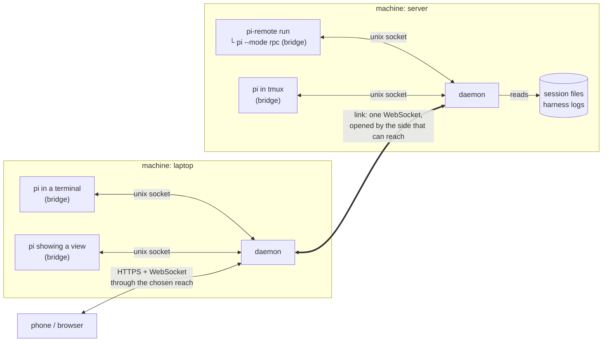
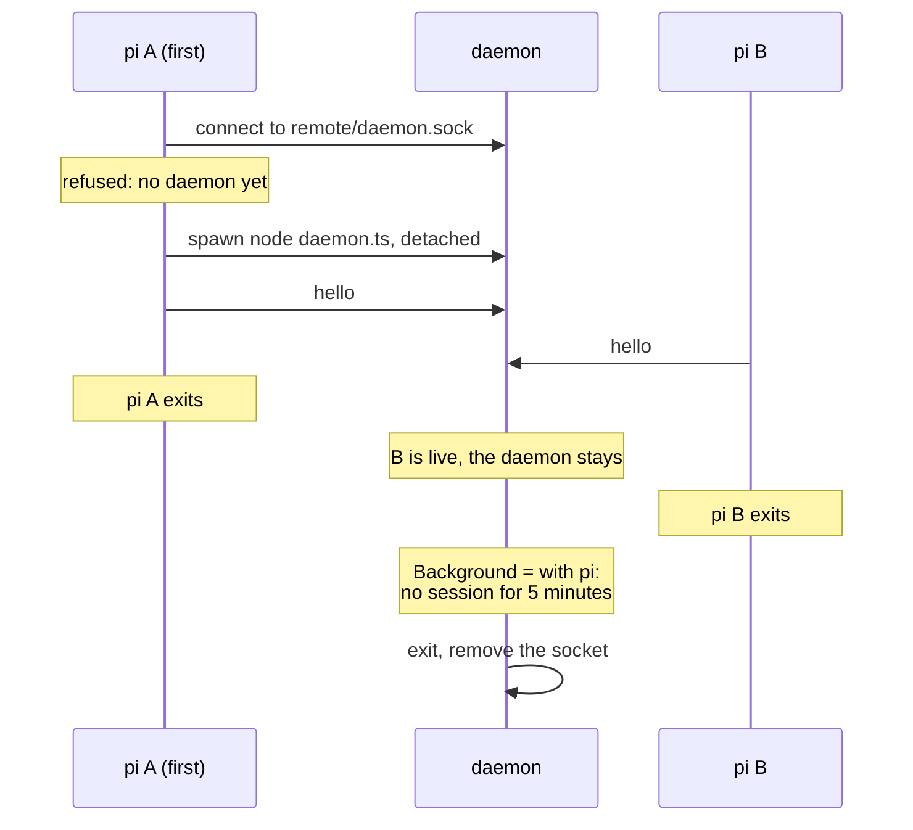
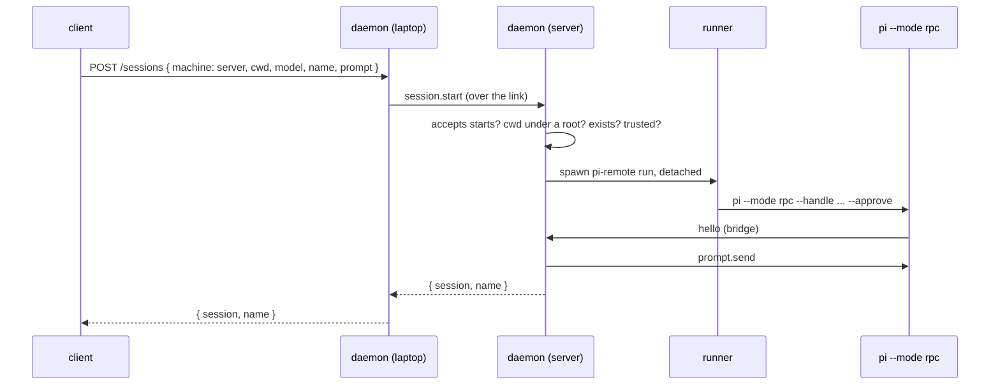
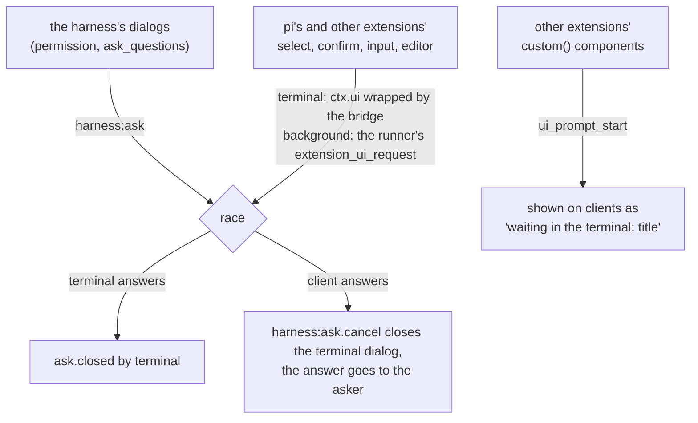

# Remote: your sessions from anywhere

This is the design for reaching pi sessions from a phone, a browser or a pi on another machine, for keeping sessions running with no terminal, and for agents on different machines to share a room. Nothing here ships yet. The plan lives in [`ROADMAP.md`](../ROADMAP.md#from-anywhere), and this document says how it works and why.

## What it is for

The agent asks for a decision while I am away from the desk, and the run waits until I come back. Most of what I need away from the desk is to answer that call, read what happened, and send the next message. The same pieces let a session run with no terminal attached, which is what a harness on a VPS needs, and let my laptop's pi drive a session on the VPS.

Six things should work when this is done:

1. I open `pi` in a terminal as I do today. My phone shows that session live, and I can answer its questions and steer it from there. Whichever side answers a question first wins, and the other side closes its dialog.
2. I close the laptop lid or leave the SSH connection, and a session started in the background keeps working. Later I take it back from any pi, on that machine or another, in the middle of a run.
3. From the phone or from my laptop's pi, I start a session on any of my machines that accepts it, in a folder I allowed.
4. On a VPS, one setting keeps the service up, and I reach it through Tailscale, a Cloudflare tunnel, or my own reverse proxy with a login page.
5. When a session needs me and I am not active on any client, the phone gets a notification.
6. An agent on my laptop and an agent on the VPS talk in one room, as two agents in one folder do today.

## Decisions

| Question                                                       | Decision                                                                                                                                                                                         | Why                                                                                                                                                                                                                                                 |
| -------------------------------------------------------------- | ------------------------------------------------------------------------------------------------------------------------------------------------------------------------------------------------ | --------------------------------------------------------------------------------------------------------------------------------------------------------------------------------------------------------------------------------------------------- |
| Build it or use [pi-mobile](https://pi.dev/packages/pi-mobile) | Build it on the kit's contracts, and take pi-mobile's good ideas                                                                                                                                 | pi-mobile forwards pi's `select`, `confirm` and `input` by replacing them on `ctx.ui`. Our permission and question dialogs are `ctx.ui.custom()` components, which it cannot forward. It also has no tasks, rulings, costs, peers or second machine |
| Who runs the daemon                                            | One per machine. The first pi starts it and it exits after 5 minutes with no session, or the Background setting keeps it up as a user service                                                    | No service to install for the common case, and one setting for the machine that should always answer                                                                                                                                                |
| How a background session runs                                  | `pi-remote run` holds `pi --mode rpc` on a pipe. Whatever keeps that process alive is the user's choice                                                                                          | Not tied to tmux: the daemon's own child, nohup, systemd, docker and tmux all work. RPC also gives a background session commands an extension cannot run (`fork`, `clone`, `new_session`)                                                           |
| How a session is taken back                                    | As a client: any pi opens a view of any session, here or on a linked machine, that takes over its screen in a frame of the agent's color. tmux is an optional runner for the exact same terminal | The same mechanism serves "take it back" and "my laptop's pi drives the VPS's pi"                                                                                                                                                                   |
| How machines see each other                                    | Daemons pair into links. A client connects to one daemon and sees every linked machine through it                                                                                                | No central server. The machine behind NAT dials out, and one connection carries both directions                                                                                                                                                     |
| Who holds the truth                                            | The machine that owns a session. Clients never sync with each other                                                                                                                              | Every client converges on the owner, so there is nothing to merge                                                                                                                                                                                   |
| Control with one operator                                      | Soft presence: no locks. The client with the latest input is the active one                                                                                                                      | One person is never in two places, so a lock only costs a key press                                                                                                                                                                                 |
| What peers and remote share                                    | Presence, the inbox, session state, addresses and `by` live in the kit. Neither package imports the other                                                                                        | Both read and write the same facts, so each has one owner                                                                                                                                                                                           |
| How the phone reaches the machine                              | The daemon listens on loopback. Tailscale serve, a Cloudflare tunnel, a bound interface or a reverse proxy expose it, with the daemon's login                                                    | Each user picks the reach they trust. The daemon never assumes a network is private                                                                                                                                                                 |
| The client                                                     | One Expo codebase for the web, iOS and Android. The daemon serves the web build                                                                                                                  | One set of screens, and the web build installs as a PWA                                                                                                                                                                                             |
| Who hosts a session                                            | Only a machine. A browser or a phone is always a client, and a pi is a client whenever it shows a view. A session never moves                                                                    | Where a session runs never depends on who asked for it, so there is one place to look for its file, its process and its truth                                                                                                                       |
| Starting sessions remotely                                     | Each machine chooses whether it hosts sessions started elsewhere, on by default, and only in folders under its roots. It publishes that policy                                                   | Starting pi in a folder runs code there. A published policy lets a client show only what will work there                                                                                                                                            |
| The permission mode `full`                                     | Never set from outside the machine                                                                                                                                                               | A stolen phone must not turn approvals off                                                                                                                                                                                                          |

## Terms

| Term    | Meaning                                                                                                                                             |
| ------- | --------------------------------------------------------------------------------------------------------------------------------------------------- |
| machine | A computer that runs the daemon. It has an id, the fingerprint of its key, and a name, its hostname unless renamed                                  |
| handle  | A session's call sign, one word drawn when it opens, such as `kestrel`. Agents mention it as `@kestrel`. See [Naming](#naming)                      |
| title   | What a session is about, such as "OAuth for the MCP server". The tasks feature writes it, and it is pi's session name                               |
| daemon  | The process of one machine. It routes, caches, serves the web app, logs clients in, starts background sessions and keeps the links                  |
| bridge  | The extension in every pi process. It publishes the session's events and runs what the daemon forwards                                              |
| runner  | `pi-remote run`, the process that holds a background session's `pi --mode rpc`                                                                      |
| link    | A trusted connection between the daemons of two machines                                                                                            |
| client  | Anything with a screen connected to a daemon that hosts nothing: the web app, the native app, or a pi's view. See [Roles](#roles)                   |
| start   | To create a pi process. It happens only on a machine                                                                                                |
| open    | To show a session that already exists, in a view, on any client                                                                                     |
| policy  | What a machine lets clients and linked machines do there, published with the machine. See [A machine's policy](#a-machines-policy)                  |
| device  | A paired client, such as a phone or a browser                                                                                                       |
| view    | Another session drawn over a pi's whole screen with that pi's own shells, in a frame of the agent's color. See [The view](#the-view)                |
| source  | Where a view, a peek or a client reads a session from: this pi, a session file, the daemon or a link. See [Sources and shells](#sources-and-shells) |
| address | `handle@machine`, such as `kestrel@server`, for people and agents. The wire uses the machine id and the session id                                  |
| epoch   | One life of a pi process. It changes when the process restarts, and with it the live stream's numbering                                             |

## The pieces



| Piece    | What it does                                                                                                                                                                                                            | Where it lives                                                                                                 |
| -------- | ----------------------------------------------------------------------------------------------------------------------------------------------------------------------------------------------------------------------- | -------------------------------------------------------------------------------------------------------------- |
| Bridge   | Publishes the session's events, answers the snapshot request, runs forwarded commands, enters the race for every dialog, registers the session in the presence index, and shows views. Starts the daemon when none runs | `@adeildo/pi-remote`, loaded by `@adeildo/pi-harness` like the other pieces                                    |
| Runner   | Holds a background session's `pi --mode rpc`: keeps its stdin open, reads its stdout, forwards its dialogs and its RPC-only commands, and exits with it                                                                 | The `pi-remote run` command of `@adeildo/pi-remote`                                                            |
| Daemon   | Keeps the live sessions and their snapshots, routes events and commands, keeps a replay buffer, serves the web app, logs clients in, starts background sessions, keeps the links, replicates rooms, sends pushes        | Another entry of `@adeildo/pi-remote`, run as its own Node process                                             |
| Protocol | The shapes on the wire, their decoders, the version, and the reducers that rebuild a transcript from events. No Node imports and no pi imports                                                                          | `@adeildo/pi-remote-protocol`                                                                                  |
| Client   | The screens. It talks only to its daemon                                                                                                                                                                                | `apps/remote`, an Expo app. Not published to npm: its web build is copied into `@adeildo/pi-remote` at release |
| CLI      | Status, sessions, the runner, views, the service, links, devices                                                                                                                                                        | The `pi-remote` bin of `@adeildo/pi-remote`                                                                    |

### What the daemon and the runner may import

They run as their own processes, so pi's extension loader does not resolve their imports. Pi installs packages without their peers, so `@earendil-works/*` is not on disk next to ours (the cause of the 5.11.1 bug, see [`scripts/smoke.ts`](../scripts/smoke.ts)). Both import only Node's standard library and `@adeildo/pi-remote-protocol`. The daemon reads pi's session files through the documented [session format](https://github.com/earendil-works/pi/blob/main/packages/coding-agent/docs/session-format.md), and the runner speaks pi's [RPC protocol](https://github.com/earendil-works/pi/blob/main/packages/coding-agent/docs/rpc.md) with its own reader, which splits records on LF only, never with Node's `readline`, as pi's documentation requires.

Both are TypeScript run by the Node binary that runs pi (`process.execPath`). Pi requires Node 22.19 or newer, where Node strips types by itself, so their code is limited to erasable syntax and their package turns on `erasableSyntaxOnly`.

## Roles

A session runs only on a machine. Who asked for it never changes where it runs.

| Who                                             | Hosts            | Opens views          | Starts sessions                          |
| ----------------------------------------------- | ---------------- | -------------------- | ---------------------------------------- |
| A pi in a terminal                              | Its own session  | Of any session       | On any machine that accepts              |
| A runner (`pi-remote run`)                      | Its own session  | No                   | No                                       |
| `pi-remote attach` (`pi --no-session --remote`) | Nothing          | The one it was given | From that view, on the viewed machine    |
| The web app, the phone                          | Nothing, ever    | Of any session       | On any machine that accepts              |
| A linked machine's daemon                       | Its own sessions | For its clients      | For its clients, on machines that accept |

- **The role comes from the transport.** A hello as `bridge` or `runner` is accepted only on the unix socket, a file with mode 0600 under the user's `~/.pi/agent/harness/remote/`, so only a process of that user on that machine registers a session. Over TCP a hello is `client` or `link`, nothing else. A browser cannot pose as a session, with or without a valid token.
- **Every start names a machine.** `session.start` carries a `machine` from the machine list, and that list holds only daemons. Clients appear only as viewers, in presence. A daemon spawns only on itself. For another machine it forwards the start over the link, and the target checks its own policy, roots and trust.
- **Sessions do not move.** A session lives where its file is, and continuing a closed one starts on that machine. To work elsewhere, start a new session there.
- **On the screens.** The new-session picker lists machines, never "this browser". A machine that refuses starts shows greyed, with the reason. A view's new-session action names the machine ("New session on server"). A pi's "open in the browser", the address and QR code from `/remote`, opens a view of that session and nothing more.

### A machine's policy

Each machine publishes what clients and linked machines may do there, so a client draws only what will work. The policy travels with the machine in `GET /machines`, over links, and in `policy.changed` when a setting changes. Logged-in clients and linked machines see it. The unauthenticated `/.well-known/pi-remote` leaves it out, because roots are paths on disk.

```ts
interface MachinePolicy {
	/** The `acceptStarts` setting. Off: only the machine's own terminal and CLI start sessions there. */
	acceptStarts: boolean;
	/** Where a start may happen, as set, `~`-relative. */
	roots: string[];
	/** What a folder pi has not trusted gets. "refuse" until open question 2 is settled. */
	untrusted: "refuse" | "ask";
	runner: "child" | "tmux";
	/** Whether clients answer other extensions' dialogs in terminal sessions here. */
	forwardOtherDialogs: boolean;
}
```

The limits every machine applies, such as never setting `full` from outside (see [What a client or a linked machine may not do](#what-a-client-or-a-linked-machine-may-not-do)), are not part of the policy, because no machine can change them.

A refused start answers with the reason, `starts-off`, `outside-roots`, `missing`, `untrusted` or `offline`, and the client shows it next to the machine. The client never decides alone: the target checks again, since the policy it drew from can be a few seconds old.

## Where state lives

| State                                                                    | Its owner                      | Where it persists                                                       |
| ------------------------------------------------------------------------ | ------------------------------ | ----------------------------------------------------------------------- |
| The conversation                                                         | The pi process                 | pi's session file, on its machine                                       |
| The harness's facts: tasks, rulings, questions, the room's messages      | The session that wrote them    | That session's harness log, on its machine. Shared rooms are replicated |
| Live state: the streamed message, open questions, the queue, mode, model | The bridge                     | Nowhere. The daemon keeps a materialized copy for clients               |
| Which sessions are open                                                  | The presence index, in the kit | `~/.pi/agent/harness/events/live/`, one file per session                |
| The machine's identity, links, devices, credentials, settings            | The daemon                     | `~/.pi/agent/harness/remote/`                                           |
| Where the operator is active                                             | The daemon                     | Memory only, sent to every client                                       |
| Drafts, scroll, the open session, the cache                              | The client                     | The client                                                              |

A client is a replica. It never holds a fact nobody else has, so losing a client loses only its cache and its outbox.

## Machines and links

- **Identity.** On its first start the daemon creates an ed25519 key in `remote/machine.json`. The machine id is the fingerprint of the public key. Its name follows [Naming](#naming).
- **Finding.** The daemon listens on port 7878 by default and answers `GET /.well-known/pi-remote` with its id, name, version, protocol version and public key. When it listens beyond loopback it also announces `_pi-remote._tcp` over mDNS, and with Tailscale it looks for the same port on each node from `tailscale status --json`. A URL typed by hand always works.
- **Linking.** Finding a machine grants nothing. On one machine, the link action on the Remote tab or `pi-remote link` shows a code good for 5 minutes. On the other, `pi-remote link <url> <code>` sends it. Each side keeps the other's public key, name and the addresses it was reached at, and every link connection opens with a handshake signed by both keys. Unlinking on either side removes the link there at once, and on the other side when it next connects.
- **Direction.** A link is one WebSocket, opened by whichever side can reach the other and reconnected by that side. The laptop behind NAT dials the server, and events and commands then flow both ways. When neither side reaches the other, there is no link, and Tailscale or a tunnel is the answer. A relay that only forwards sealed bytes is planned for later.
- **Through one daemon.** A client connects to one daemon and sees every machine linked to it. That daemon forwards the client's commands to the machine that owns the session, and the events back. A linked machine is trusted like a paired device: it may do what a device may do and nothing more, and a command keeps the `by` of the client that sent it.
- **What crosses a link.** Each side's session list and states, the streams of sessions someone on the other side is viewing, the commands for those sessions, and the shared rooms both machines are members of. Files, settings and credentials never cross.

## Naming

A name has to be short enough to type and say, stable enough that an agent can keep using it, and editable. No single string does all three, so every session and machine has three layers, the way petname systems keep a secure key under a memorable name ([Zooko's triangle](https://files.spritely.institute/papers/implementation-of-petname-system-in-existing-chat-app.html)).

| Layer   | Session                                                       | Machine                              | Changes                                                                                          |
| ------- | ------------------------------------------------------------- | ------------------------------------ | ------------------------------------------------------------------------------------------------ |
| id      | pi's session id                                               | The fingerprint of the machine's key | Never. The disk and the wire keep ids only, mentions included                                    |
| handle  | One word drawn from the harness's list when the session opens | The hostname, cleaned                | Only when the operator renames it                                                                |
| aliases | Earlier handles                                               | Earlier names                        | Resolve while the session is live or closed less than 7 days ago, unless someone else holds them |

A session also has a title, what it is about, which the tasks feature writes and which is pi's session name. People read `kestrel · OAuth for the MCP server`; agents write `@kestrel`. The handle is a call sign, never the only label: the title next to it says what the session is.

### The word list

The list lives in the kit, and its flavor is sky and field. π is the circle constant and the harness's mark is a π, so half the words are things that orbit (moons, stars, constellations, comets) and half are a naturalist's field guide (birds, trees, stones, the sea):

```text
sky     vega  rigel  deneb  lyra  titan  miranda  oberon  phoebe  callisto  halley
field   kestrel  heron  wren  birch  juniper  quartz  basalt  fjord  kelp  orca
```

A test holds the list to these rules:

- At least 600 words, so 7 days of reserved handles still leave most of the list free. The operator's sessions run at about 70 a week.
- Lowercase ASCII, 3 to 8 letters, one word.
- Every word has its own first three letters, so `@kes` and Tab completes it ([EFF's short list](https://www.eff.org/deeplinks/2016/07/new-wordlists-random-passphrases) has the same property).
- Any two words are at least 3 edits apart, so one typo still resolves to one word.
- No word that reads as code or as an instruction (`test`, `main`, `build`, `merge`, `push`), and none that is a pi or harness command.

### Drawing a handle

- On `session_start`, a session with no handle draws a word at random among those nobody holds or reserves: the handles and aliases of live sessions and of sessions closed less than 7 days ago, on this machine and on the linked machines it knows.
- The handle is logged once, in `session.named`, and never recomputed from the order sessions opened in.
- A continued session keeps its handle when nobody else holds it. When someone does, it draws a new one and logs a rename.
- With every word taken, the draw adds a number (`kestrel-2`), once, and keeps it.
- Two machines out of contact can draw the same word. Neither is renamed: where both appear they show as `kestrel@laptop` and `kestrel@server`, and a bare `@kestrel` there asks which one.

### Machine names

- The hostname, cleaned to lowercase letters, digits and dashes (`John's-MacBook-Pro.local` becomes `johns-macbook-pro`). It follows the hostname until the operator edits it, and editing pins it, as [Tailscale](https://tailscale.com/kb/1098/machine-names) does.
- Unique among linked machines. A link that would bring a second `server` asks for another name, suggesting `server-2`, before it completes.

### Renaming

- Only the operator renames: a session from the panel or `pi-remote rename`, a machine from the Remote tab or `pi-remote machines rename`. Agents never rename, and nothing renames by itself.
- A rename is a fact in the log, `session.renamed { from, to, by }` or `machine.renamed { from, to }`, sent over the links like any other. Every reader computes names from these facts, the way a Matrix room carries each display name change as an event.

### What the agent knows

- **Itself.** A `harness_identity` section in pi's structured system prompt (`systemPromptOptions.sections`) says its handle, its machine, how others mention it, and its earlier handles. Pi records a changed section as a delta in the transcript, so a rename costs a few tokens and the cached prompt stays valid.
- **The others.** Peers' notes, which already say who joined and who left, say "heron is now db (was heron)".
- **Old names it writes.** A mention of an alias reaches the session that holds it, and the writer's agent is told "delivered to auth (was oauth)", so its next message uses the new handle.
- **Old names it reads.** A message keeps its text as typed, and its `to` holds session ids. A screen draws the current handles; the agent reads the text as written, with the rename notes before it.

## The daemon's lifecycle



- **Start.** On `session_start`, the bridge connects to `daemon.sock` under `~/.pi/agent/harness/remote/`. When nothing answers, it spawns the daemon with `detached: true` and `stdio: "ignore"`, then connects with a short backoff. Binding the socket is the lock: of two daemons started at once, the second exits. A socket file with no process behind it is removed after a failed connect.
- **The Background setting.** `with pi`, the default, lets the daemon exit after `idleExitMinutes` with no session, while no background session exists. `always` installs a user service and keeps the daemon up:
  - Linux: `~/.config/systemd/user/pi-remote.service` running `pi-remote serve`, enabled and started. It asks before running `loginctl enable-linger`, which keeps it up with nobody logged in.
  - macOS: a LaunchAgent in `~/Library/LaunchAgents/` with `RunAtLoad` and `KeepAlive`.
  - Elsewhere: the setting says no service manager was found and shows the `pi-remote serve` line to run under any supervisor.

  Going back to `with pi` stops and removes the service. `pi-remote service install | uninstall | status` does the same from a shell.

- **Handover.** When the service starts while a daemon started by a pi holds the socket, it asks that daemon to exit, waits for the socket and takes it. Bridges, runners and clients reconnect and resync.
- **Status.** `pi-remote status` and the Remote tab show the pid, who started the daemon (a pi, the service, or a shell), uptime, version, reach and links.
- **Upgrade.** Every hello carries the protocol version and the package version. A daemon older than a connecting bridge exits as soon as no client request is in flight, and the bridges start the new one. Losing the daemon loses only its replay buffer, because everything else it keeps is a file.
- **Web app version.** The daemon reads the web build into memory when it starts and serves that copy, so `pi update` replacing the files never hands the phone an app that does not match the daemon.

## Sessions

### Two kinds

| Kind       | Started by                                                 | Kept alive by                                                                     | Taking it back                                                                                   |
| ---------- | ---------------------------------------------------------- | --------------------------------------------------------------------------------- | ------------------------------------------------------------------------------------------------ |
| Terminal   | You, running `pi` in a terminal                            | The terminal                                                                      | It is in that terminal. Any other pi or client opens a view of it                                |
| Background | `pi-remote new`, the phone, or a view's new-session action | The runner, under the daemon by default, or under nohup, systemd, docker, or tmux | A view from any pi (`pi-remote attach kestrel@server`), or `tmux attach` when the runner is tmux |

Both kinds load the bridge, so clients see no difference beyond the commands a background session adds.

### The runner

`pi-remote run [folder] [--handle h] [--title t] [--model m] [--session id] [--approve | --no-approve]` starts `pi --mode rpc` with those flags, the title as pi's `--name` and the handle as `--handle`, a flag the bridge registers. It then:

- keeps pi's stdin open, because closing it is how pi shuts down in RPC mode;
- reads pi's stdout continuously, since a reader that stops can stall pi;
- forwards pi's `extension_ui_request` dialogs (`select`, `confirm`, `input`, `editor`) to the daemon as questions, writes the answer back as `extension_ui_response`, and forwards `notify`, `setStatus`, `setWidget` and `setTitle` as notices;
- runs the commands only RPC has (`fork`, `clone`, `new_session`, `switch_session`, `get_tree`, `get_entries`, `clear_queue`, `get_commands`, `get_session_stats`) for clients;
- exits when pi exits, with pi's exit code, and on SIGTERM closes pi's stdin, then kills pi after a grace period.

The bridge runs inside that pi as in any other and does everything else. When the runner dies, pi's stdin closes and pi shuts down, so a background session never outlives its runner.

The daemon starts the runner as its own detached child in a new session (`setsid`), with its output in `remote/runs/<handle>.log`, so a background session outlives the daemon that started it. Any supervisor works as well:

```bash
nohup pi-remote run ~/Projects/x &
systemd-run --user pi-remote run ~/Projects/x --handle vega
tmux new -d -s pi-vega pi --handle vega      # the tmux runner: an interactive pi
```

With `runner: tmux` on the Remote tab, the daemon starts an interactive pi in a detached tmux session instead, and `pi-remote attach` on that machine offers `tmux attach -t pi-<handle>`.

### Trust

Pi resolves project trust before it loads extensions, so the bridge cannot forward that question. In RPC mode with no saved decision, pi skips the project's resources without asking. A background session started in a folder pi has not trusted would therefore run silently without the project's extensions. The runner never leaves that to chance: it reads `~/.pi/agent/trust.json` for the folder and its parents, and passes `--approve` or `--no-approve` explicitly. A folder with no decision is refused, with a line saying to trust it from a terminal, until the open question on asking from the phone is settled.

### The view

Opening a session takes over the screen: the same header, transcript, editor and footer as your own session, filled with that session, inside one frame in its agent's color. The top edge says whose it is and where (`vega @ server`, the title), with `live` on the right. The bottom edge says the way back (`esc back to kestrel`). When the machine is out of contact the frame is dashed and `dim`, and the right of the top edge says `as of 14:02`, the meaning dashed already has in the transcript and the panel.

```
╭─ vega @ server   Fix the release workflow ────────────────── live ─╮
│ ╭─ ▸ you ────────────────────────────────────────────────────────╮ │
│ │ e já fazer merge da release certinha                           │ │
│ ╰────────────────────────────────────────────────────────────────╯ │
│ ╭─ ⟩_ bash ──────────────────────────────────────────────────────╮ │
│ │ $ git pull -q --ff-only && git log --oneline -2                │ │
│ │ 40ccbf1 chore(main): release 5.9.2 (#38)                       │ │
│ ╰─ ✓ done  1.9s ─────────────────────────────────────────────────╯ │
│  Fiz o push da correção, e a release 5.9.2 está publicada.         │
│ ╭─ main ──────────────────────── ~/Projects/pi-harness   server ─╮ │
│ │ ❯                                                              │ │
│ ╰─ Claude Opus 5.5   medium   ctx 4%  39k/1M ────────────────────╯ │
╰─ esc back to kestrel   alt+g panel ────────────────────────────────╯
```

Nothing in it is drawn a second time. A spike drew a real session of this machine from its file this way:

- **The transcript** is pi's own components (`UserMessageComponent`, `AssistantMessageComponent`, `ToolExecutionComponent`, `CustomMessageComponent`, `BashExecutionComponent`), which pi exports and which draw from data. The look already frames pi's entries in every component of the process, so the view gets the harness's frames without asking.
- **Tool calls** draw through the look's chain of renderers, over pi's own definitions of its tools (`createBashToolDefinition` and the rest, exported) and the harness's renderers. A tool only the other session has shows in the look's generic frame: pi does not hand an extension the renderers of another (`getAllTools` gives no renderers).
- **The header, editor and footer** are the look's, drawn from a `Snapshot` the other session publishes: its folder, branch, machine, model name, thinking level, context and account.
- **The frame** is the kit's `entryFrame`, solid or dashed.

Pi itself cannot be pointed at another session (`InteractiveMode` takes a concrete `AgentSessionRuntime`), so the view is a full-screen layer over your pi, as `Alt+G` is, and Esc leaves your session as it was. The frame costs four columns.

- `enter` in the panel opens it, for any session in it. `pi-remote attach kestrel@server` runs `pi --no-session --remote kestrel@server`, a flag the bridge registers with `pi.registerFlag`, which opens straight into the view and closes pi with it.
- **Two voices.** The view's editor is you prompting that session: `prompt.send`, `by: terminal`, depth 0, with `deliverAs` set the way pi's editor sets it while a run is under way. A room is mail between agents, as today. Both exist, and the view never posts to a room.
- A question the viewed session asks is asked again locally on `harness:ask`, so the viewing pi's ask-questions draws it exactly as it draws its own. The answer goes back as `ask.answer`.
- A background session's view adds the RPC-only actions: fork, clone, a new session in the same folder, the tree.
- **Without remote**, a session of this machine still opens, read only, from its file followed as it grows, and the editor gives way to a line that says to write to it through the room.

### Sources and shells

Everything that shows a session draws from a source, and the same shells draw whatever source they are given.

```
                ┌ this pi                 pi.on, ctx                      ┐
source ─────────┼ a session file here     read and followed, read only    ┼──► shells: transcript, header and footer,
                ├ another pi here         the daemon's socket             │            editor, questions, tasks, peek
                └ another machine         the link                        ┘
```

```ts
interface SessionSource {
	/** The live state: the Snapshot, open questions, the queue, the mode. */
	snapshot(): Promise<SessionState>;
	/** Entries and events after a cursor, then live ones until stopped. */
	follow(after: Cursor, on: (item: SourceItem) => void): () => void;
	/** Undefined on a source that only reads, such as a file. */
	send?(command: Command): Promise<Reply>;
}
```

It has four adapters, so it is a real seam. The kit holds the interface and the two adapters that need nothing but the machine; remote registers the other two on `harness:sources`. The look owns the shells, since it draws the screen, so it draws the view when the panel asks on `harness:view.open`. Peers, the look and remote still never import each other. The panel's peek, the view and the web app's reducers all read through a source; your own session keeps pi's own screen.

### One writer per session

Pi has no lock on a session file. The bridge adds one: on `session_start` it registers the session in the presence index, and when a live process already holds that session, it says so in the chat and names the view that reaches it. A session continued from another machine starts on the machine that holds its file.

### Starting a session remotely



- **Where.** Only on a machine whose policy accepts starts, and only in a folder under one of its roots, `~` by default, with symlinks resolved before the check. The folder picker lists the folders under each root, recent session folders first.
- **How.** The daemon passes only the handle it drew, the title when the client gave one, `--model`, `--session`, and the trust flag. Everything else comes from the folder's settings.
- **Continuing a closed session.** The session list includes recent sessions no process holds. Opening one starts a runner with `--session <id>` on the machine that holds it.
- **Stopping.** A client can ask any session to end (`ctx.shutdown()`, which waits for `agent_settled`), and kill a background session with `force`.
- **A crashed background session** shows as crashed with a continue action. Nothing restarts it by itself, because a run that died mid-tool may have left work half done.

## Sync

### Three kinds of data, three cursors

| Data                | Nature                                    | Cursor                                                                          |
| ------------------- | ----------------------------------------- | ------------------------------------------------------------------------------- |
| The conversation    | Durable, append only, a tree of entries   | pi's entry id. Pi documents it as a durable cursor (`get_entries` with `since`) |
| The harness's facts | Durable, append only, one writer per file | The byte offset in the file                                                     |
| Live state          | Ephemeral                                 | `(epoch, seq)`: `seq` is assigned by the bridge and restarts with each epoch    |

For a background session the daemon asks the runner for `get_entries`. For a terminal session it reads the session file itself and remembers a byte offset per file, so following a session costs one read of what was appended.

### The first load

1. The client asks for the machines and the sessions: a small list with names, states, costs and last lines. It draws at once.
2. Opening a session fetches a snapshot: the tail of the active branch, from the last compaction or the last 50 messages, whichever is shorter, plus the live state and the entry cursor. Then the live stream follows from the snapshot's `seq`.
3. Older history comes in pages as the client scrolls up, by entry id.

### The cache

Each client keeps what it downloaded, keyed by machine, session and entry id: IndexedDB on the web, SQLite in the native app, a file under `remote/cache/` for a viewing pi. The next time it draws the cache at once and asks for the entries after its cursor, then the live snapshot. When the owner does not know the cursor, the client drops that session's cache and fetches the tail again. Logging out, unpairing or unlinking clears the cache.

### Resuming the live stream

A client that reconnects sends `(epoch, seq)` for each open session. When the epoch matches and the daemon still holds every event after that `seq`, it sends them. Otherwise it asks the bridge for a snapshot. A new epoch always means a snapshot.

### Rooms across machines

Linked daemons exchange, for every shared room both machines are members of, each file's name and size. The side with more sends the bytes after the other's size, and the receiver appends them to `rooms/<id>/<session>.jsonl`. A file has one writer, local or replicated, so replication never conflicts. A daemon forwards room files to its other linked members, and the same bytes arriving by two paths are recognized by offset.

## Offline

### Rules

- **Only the owner declares a session ended.** A lost link makes a remote session "out of contact since 14:02", never ended.
- **Timeouts use the measuring side's monotonic clock.** `at` is for display. Order comes from `seq` or the offset, never from another machine's clock.
- **Nothing blocks pi.** With the daemon gone, the bridge keeps working, drops deltas, and its facts are on disk already.
- **Commands carry an id.** The bridge keeps the last 1,000 ids per session and ignores a repeat, so resending is safe.

### Heartbeats

| Connection        | Ping every | Lost after | Starting value, to tune |
| ----------------- | ---------- | ---------- | ----------------------- |
| Bridge and daemon | 10 s       | 3 missed   | yes                     |
| Client and daemon | 15 s       | 3 missed   | yes                     |
| Link              | 15 s       | 3 missed   | yes                     |

### When something goes away

| What goes                                 | Who notices                                           | What clients show                                                    | What happens to what was pending                                                                                                                                               | Coming back                                                                                  |
| ----------------------------------------- | ----------------------------------------------------- | -------------------------------------------------------------------- | ------------------------------------------------------------------------------------------------------------------------------------------------------------------------------ | -------------------------------------------------------------------------------------------- |
| A client                                  | The daemon: the socket closes or pings stop           | It leaves the viewer marks, and notifications apply again            | What was typed stays in the client's outbox                                                                                                                                    | See [the outbox](#the-outbox)                                                                |
| The daemon                                | Bridges, runners, clients, links                      | "Reconnecting"                                                       | Sessions keep running, background ones included. The replay buffer is lost                                                                                                     | Bridges reconnect (with `with pi`, one starts a daemon); clients resume or take a snapshot   |
| A bridge's socket                         | Both ends                                             | The session as "reconnecting"                                        | Open questions stay open in the terminal                                                                                                                                       | The hello carries `(epoch, seq)`; open questions come back in the snapshot                   |
| pi, ending normally                       | The bridge sends `session.ended`                      | The session moves to recent                                          | Open questions close with `by: gone`; pending commands are refused                                                                                                             | Continue opens it with `--session`                                                           |
| pi, crashing                              | The daemon: the socket closes and the process is gone | "Crashed", with the last known state                                 | The message being streamed is lost; the session file ends at the last finished message                                                                                         | Continue. The run does not restart by itself                                                 |
| pi, frozen (a sleeping laptop, `SIGSTOP`) | Pings go unanswered while the process exists          | "Not answering"                                                      | Nothing                                                                                                                                                                        | It answers again by itself                                                                   |
| A link, or the machine behind it          | Both daemons                                          | The machine "offline since 14:02"; its sessions greyed "as of 14:02" | Commands to it are refused at once, with an offer to keep them in the outbox. Its questions show "waiting on server". Room messages to its agents stay in my log, on their way | The handshake exchanges cursors and fills the gaps; room messages arrive and get their ticks |
| A machine, for good                       | Nobody can tell it from a long outage                 | Offline indefinitely                                                 | Nothing                                                                                                                                                                        | Unlinking it removes its sessions and replicas from every list                               |

### The outbox

What a client sends while it cannot reach the owner waits in an outbox on that client, each item with its id and the time it was typed, marked "not sent". After a reconnect, items typed in the last 2 minutes go out in order on their own. Older items wait for the operator to send, edit or discard them, because "go ahead and push" from an hour ago is not the same instruction now. An answer to a question that someone else answered meanwhile comes back as "answered on laptop" and is dropped.

### Presence and liveness

The presence index in the kit is the one list of open sessions, read by peers and remote alike. An entry holds the session id, the machine id, the pid, the process start time, the folder, the name and the state.

- **A local entry is live** while a process with that pid and that start time exists. The start time comes from `/proc/<pid>/stat` on Linux and `ps -o lstart=` on macOS. A pid the system gave to another process no longer passes, and neither does another user's process.
- **A remote entry is live** while its lease is fresh. The daemon writes the entries of linked machines' sessions and touches them every 15 seconds while the link is up. A reader treats an entry whose file is older than 45 seconds, by its own clock, as out of contact.
- **A session's state** is pi's own vocabulary from the [program status protocol](https://github.com/earendil-works/pi/blob/main/packages/coding-agent/docs/terminal-setup.md#program-status): `working`, `blocked`, `done`, `error`, `idle`. Peers' flag, remote's push and the session list read this one state.

## The protocol

### Transport

- **Clients and their daemon:** HTTP for login, the session list, snapshots, history pages and files, and one WebSocket per client for everything live. JSON text frames.
- **Bridges and runners with their daemon:** the unix socket, one JSON object per line, split on LF only. Only here does a hello take the role `bridge` or `runner`; elsewhere it is `client` or `link` (see [Roles](#roles)).
- **Daemons over a link:** one WebSocket, the same envelopes, with `permessage-deflate`.

### Envelope

```ts
interface Envelope {
	v: 1;
	kind: "hello" | "event" | "state" | "command" | "reply" | "error";
	/** The machine that owns the session. Absent for messages about the connection itself. */
	machine?: string;
	/** pi's session id. */
	session?: string;
	/** The life of the pi process that sent it. */
	epoch?: string;
	/** Per epoch, increasing, assigned by the bridge. */
	seq?: number;
	/** Pairs a command with its reply, and makes a resent command a repeat. */
	id?: string;
	type: string;
	data: unknown;
	at: number;
	/** Who caused it. */
	by?: { kind: "terminal" | "client" | "agent"; name: string; machine: string };
}
```

A shape only grows. A field that changes meaning gets a new name, and an incompatible change gets `v: 2`, the rule the harness log follows.

### Naming

One name per fact, the same on disk, on the wire and inside the process.

| Kind               | Form                                 | Examples                                                                 |
| ------------------ | ------------------------------------ | ------------------------------------------------------------------------ |
| A fact             | `<subject>.<verb in the past>`       | `ask.opened`, `call.ruled`, `mode.changed`, `machine.linked`             |
| A command          | `<subject>.<verb in the imperative>` | `prompt.send`, `ask.answer`, `model.set`, `session.stop`                 |
| A state            | `<subject>`                          | `tasks`, `account`, `mode`, `peers`                                      |
| pi's own events    | `pi.<pi's name>`, unchanged          | `pi.message_update`, `pi.agent_settled`                                  |
| Inside the process | `harness:` + the name                | `harness:tasks` to ask the state, `harness:tasks.changed` for its change |

The log types already on disk keep their names, because readers depend on them: `activity`, `session.state`, `session.prompted`, `tasks.board`, `request.bid`. Inside the process, `defineContract` emits a change on both `harness:<name>.changed` and the older `harness:<name>:changed` while packages of earlier versions can be installed beside it.

Ephemeral events never reach the disk or the replay buffer beyond the message being streamed: `pi.message_update`, `pi.tool_execution_update`, `presence.changed`, `draft.typed`.

### The snapshot

| Field                                     | From                                                               |
| ----------------------------------------- | ------------------------------------------------------------------ |
| The tail of the active branch, its cursor | `ctx.sessionManager.getBranch()`, or `get_entries` from the runner |
| The message being streamed                | The bridge's copy of the partial message                           |
| The queue                                 | The last `queue_update`                                            |
| Model, thinking level, context use        | `ctx.model`, `ctx.thinkingLevel`, `ctx.getContextUsage()`          |
| Tasks and decisions                       | `TASKS.current()`                                                  |
| Rulings of the calls in view              | `RULING.current()` for each call                                   |
| Open questions                            | The bridge's list of open asks                                     |
| Permission mode                           | The permission feature's state                                     |
| Account and quota windows                 | `ACCOUNT.current()`                                                |
| Peers in the folder                       | `PEERS.current()`                                                  |
| Cost of the session                       | The session's usage totals                                         |
| Viewers and the active client             | Added by the daemon                                                |

### Events

**`pi.*`** is pi's event stream in the shapes of its [JSON and RPC modes](https://github.com/earendil-works/pi/blob/main/packages/coding-agent/docs/json.md), so the client follows pi's rules for rebuilding a streamed message: buffer the deltas of each `contentIndex`, replace the block on its `*_end`, and replace the whole message on `message_end`. The bridge subscribes with `pi.on()` and drops the cumulative `partial` fields, as pi's JSON mode does. `pi.model_select` has no JSON form in pi, so the bridge sends one in the same style.

**Harness facts:**

| Event              | Data                                                             | Logged |
| ------------------ | ---------------------------------------------------------------- | ------ |
| `tasks.changed`    | `SessionTasks`                                                   | yes    |
| `call.ruled`       | `{ toolCallId, ruling: CallRuling }`                             | yes    |
| `ask.opened`       | `{ id, source, questions: AskQuestion[], expiresAt? }`           | yes    |
| `ask.closed`       | `{ id, by, result: AskResult }`                                  | yes    |
| `mode.changed`     | `{ mode: "manual" \| "edits" \| "judge" \| "full" }`             | yes    |
| `account.switched` | `AccountState`                                                   | yes    |
| `peers.changed`    | `{ peers: PeerMark[], unread }`                                  | no     |
| `context.pruned`   | `{ calls, tokensFreed, rewriteCost }`                            | yes    |
| `turn.used`        | `{ input, output, cacheRead, cacheWrite, cost, model }`          | yes    |
| `prompt.received`  | `{ by }`, written next to a prompt that came from a client       | yes    |
| `notice.shown`     | `{ text, level }`, from `ctx.ui.notify` and the runner's notices | no     |

**Session and machine facts**, from the bridge and the daemon:

| Event               | Data                                                                       |
| ------------------- | -------------------------------------------------------------------------- |
| `session.live`      | `{ pid, startedAt, cwd, name, kind: "terminal" \| "background", runner? }` |
| `session.state`     | `{ state: "working" \| "blocked" \| "done" \| "error" \| "idle" }`         |
| `session.gone`      | `{ reason: "exit" \| "crash" \| "unanswered" }`                            |
| `session.renamed`   | `{ from, to, by }`, logged                                                 |
| `machine.renamed`   | `{ machine, from, to }`                                                    |
| `policy.changed`    | `{ machine, policy }`, see [A machine's policy](#a-machines-policy)        |
| `terminal.prompted` | `{ open, kind, title }`, from `ui_prompt_start` and `ui_prompt_end`        |
| `machine.online`    | `{ machine, name, version }`                                               |
| `machine.offline`   | `{ machine, since }`                                                       |
| `presence.changed`  | `{ clients: { name, machine, active }[], terminal: boolean }`              |

### Commands

| Command           | Data                            | Runs                                                                 | Where      |
| ----------------- | ------------------------------- | -------------------------------------------------------------------- | ---------- |
| `prompt.send`     | `{ text, images?, deliverAs? }` | The kit's inbox (see [Peers and remote](#peers-and-remote))          | any        |
| `queue.clear`     |                                 | Returns the queued text, as pi's Esc does                            | any        |
| `run.abort`       |                                 | `ctx.abort()`                                                        | any        |
| `ask.answer`      | `{ ask, result: AskResult }`    | Wins the race for that question when it is still open                | any        |
| `model.set`       | `{ provider, id }`              | `pi.setModel()`                                                      | any        |
| `thinking.set`    | `{ level }`                     | `pi.setThinkingLevel()`                                              | any        |
| `mode.set`        | `{ mode }`                      | The permission feature's own change. `full` is refused from a client | any        |
| `session.compact` | `{ instructions? }`             | `ctx.compact()`                                                      | any        |
| `session.rename`  | `{ name }`                      | `pi.setSessionName()`                                                | any        |
| `session.stop`    | `{ force? }`                    | `ctx.shutdown()`, or with `force` the runner's kill                  | any        |
| `output.get`      | `{ toolCallId }`                | The call's whole output                                              | any        |
| `entries.get`     | `{ since?, before?, limit }`    | A page of entries                                                    | any        |
| `session.fork`    | `{ entryId }`                   | RPC `fork`                                                           | background |
| `session.clone`   |                                 | RPC `clone`                                                          | background |
| `tree.get`        |                                 | RPC `get_tree`                                                       | background |

A terminal session cannot fork, clone or switch from outside: pi offers those only inside a slash command. Every command from a client is logged with its `by`, and a prompt from a client shows in the terminal as `From <client>: …`.

### The daemon's HTTP API

| Route                                 | Does                                                                   |
| ------------------------------------- | ---------------------------------------------------------------------- |
| `GET /.well-known/pi-remote`          | Machine id, name, version, protocol, public key                        |
| `GET /health`                         | Version, protocol, uptime                                              |
| `POST /login`, `POST /logout`         | Password login, a cookie for the web app                               |
| `POST /pair`, `POST /pair/claim`      | Pairing a device with a code or a QR                                   |
| `GET /devices`, `DELETE /devices/:id` | The paired devices, and revoking one                                   |
| `GET /machines`                       | This machine and the linked ones, with their state and policy          |
| `GET /sessions`                       | Sessions of every machine it sees, live first, sorted by who needs you |
| `POST /sessions`                      | Starts a background session on a machine that accepts starts           |
| `GET /sessions/:machine/:id/entries`  | Entries by cursor, in pages                                            |
| `GET /folders?machine=&root=`         | Folders under an allowed root, for the picker                          |
| `GET /models?machine=`                | The models that machine can use, from a live bridge                    |
| `POST /push`                          | Registers a Web Push subscription or a native push token               |
| `GET /ws`                             | The WebSocket                                                          |

## Streaming and performance

- **The bridge batches.** Deltas of one message are joined in windows of about 33 ms, so a fast model costs about 30 frames a second, not one per token. The bridge does constant work per delta and never builds a snapshot on that path. `bun run bench:typing` must show no cost from the bridge on a local session.
- **Interest decides volume.** Only a session some client has open streams deltas and tool output to it. The others send state changes only. Over a link, a daemon sends a session's stream only while a client on the other side views it.
- **Tool output in the stream** is the last 4 KB of each call, at most 10 updates a second. The whole output is fetched with `output.get`.
- **Backpressure.** Each client has a bounded queue. When a slow client passes the bound, the daemon drops its pending deltas and sends a resync with the current message. Deltas can be dropped because `message_end` replaces the message; facts are never dropped.
- **Large payloads** (images, whole outputs, history pages) go over HTTP, never through the WebSocket.
- **Memory.** The daemon's replay buffer has a byte budget across the machine, and a session's deltas collapse into its current message once that message ends.
- **pi's own backpressure.** The runner reads pi's stdout continuously, so a slow client never stalls pi.

## Peers and remote

Peers works today with files only: each session writes its own log, and the others read it. Remote adds a process per machine and a second machine. The two meet in several places, and each meeting has one owner.

### What moves to the kit

| Piece         | What it is                                                                                                                                                   |
| ------------- | ------------------------------------------------------------------------------------------------------------------------------------------------------------ |
| Presence      | The one index of open sessions, with machine, pid, start time and lease, as described in [Presence and liveness](#presence-and-liveness)                     |
| Session state | `working`, `blocked`, `done`, `error`, `idle`                                                                                                                |
| The inbox     | The one way to put a message into a session. It decides between starting a run, steering and following up, and puts the operator's messages ahead of agents' |
| Names         | The word list, the draw, renames and aliases, and the identity section, as described in [Naming](#naming)                                                    |
| `by`          | Who caused a fact: a terminal, a client, or an agent, with the machine                                                                                       |
| Machines      | `harness:machines`, a state contract remote fills: each machine's name, link state, last contact and policy. Without remote it holds this machine only       |
| Sources       | The `SessionSource` interface, the adapters for this pi and for a session file, and `harness:sources`, where remote adds its daemon and link adapters        |
| Views         | `harness:view.open`, a request the look answers by drawing the view with its shells. Without the look nobody answers, and the panel offers no view           |

Peers and remote each use these and never import each other. Peers works without remote as it does today. Remote works without peers through the CLI and the web app, with no rooms and no `Alt+G` panel.

### What peers keeps, changes and drops

Peers was built for one folder on one machine. Its redesign keeps what earns its keep and drops what costs more than it gives.

|         | What                                                                                                                                                                                                                                                                                   |
| ------- | -------------------------------------------------------------------------------------------------------------------------------------------------------------------------------------------------------------------------------------------------------------------------------------- |
| Keeps   | The folder's room, one per folder per machine. Shared rooms. The board: what each session does, waits on, edited and committed. Drafts drawn as agents type. `@name` and `@everyone` from your chat. The panel                                                                         |
| Changes | Agents write to each other by mail, and only you wake or cut in by default (see [Agent mail](#agent-mail)). A shared room is a list of sessions, on any linked machine. A color comes from the handle. Names, presence, the inbox, session state and the text filter come from the kit |
| Drops   | `@anyone` and its bids (`bid.ts`, the 6 s window to bid and the 8 s to take): you pick an agent with `@name` or in the panel. Folders as members of a shared room, with the exceptions for sessions removed by name. The footer's `@N`                                                 |
| Later   | A default room by git remote, spanning machines                                                                                                                                                                                                                                        |

#### Agent mail

- **By default, an agent's message is mail.** It waits for the receiver's next turn and never wakes an idle agent nor cuts into a run. Your messages always wake and cut in.
- **A setting changes it**, "When an agent writes to another", on the Peers tab: `mail` (the default), `wakes it when idle`, or `wakes it and cuts in`. The limits on chains, quiet after 4 replies and 8 cut-ins per run, apply only to the two waking steps, and they travel with the message across machines.
- **Writing to an idle agent asks the board first.** The `peers` tool returns the receiver's board line (idle since when, what it last edited and committed) and sends only when called again with `send: true`. A question such as "are you touching src/auth.ts?" is mostly answered there and never reaches anyone. A message to a working agent goes at once.

#### Unread

The footer's `@N` counted messages this session's agent had not read, which is the agent's business, not yours. It also counted every message to everyone in the folder's whole history, including those written before the session opened (the `summary()` of `here.ts` skips the opening-time filter its other readers apply), so it read `@92`. It goes. "Unread" stays in the panel, per room, and means what you have not seen there since you last opened that room.

#### Colors

A session's color comes from its handle, a hash over six hues (`syntaxKeyword`, `syntaxString`, `syntaxVariable`, `syntaxType`, `syntaxFunction`, `syntaxNumber`), so the same handle has the same color on every machine and client with no log to agree on it. The draw avoids a word whose color a live session in the same room already wears, while one is left.

#### Upgrading the rooms you have

Each folder member of a shared room becomes the sessions open from that folder at the upgrade, written as plain session members. New sessions there are no longer pulled in. Old `@anyone` requests and bids stay in the history as plain lines.

### Where they meet

| Meeting                                                          | Resolution                                                                                                                                                                                                         |
| ---------------------------------------------------------------- | ------------------------------------------------------------------------------------------------------------------------------------------------------------------------------------------------------------------ |
| Two lists of open sessions                                       | One, in the kit. The daemon writes the other machines' sessions into it                                                                                                                                            |
| Two machines drawing the same handle while out of contact        | Neither is renamed. Where both appear they show as `kestrel@laptop` and `kestrel@server`, and a bare `@kestrel` there asks which                                                                                   |
| Is a prompt from the phone the operator?                         | Yes. It is `by: client`, depth 0, and it counts as the operator's first message for a session peers keeps from being woken until then                                                                              |
| A replicated log saying `from: "you"`                            | It means the operator typed it in that session on that machine. Only a linked machine's daemon writes replicas, and only from the link                                                                             |
| Peers waking or steering a session while a client sends a prompt | Both go through the kit's inbox, which orders them in the one thread of the process                                                                                                                                |
| Peers' "waits on you" flag and remote's push                     | Both read the session state `blocked`                                                                                                                                                                              |
| Agents on two machines writing to each other                     | A shared room spans machines; its members carry their machine. Mail by default; with the wake setting on, the reply depth travels with the message, so the limit on agents waking each other holds across machines |
| A message to an agent whose session ended                        | Marked "not delivered: kestrel closed", with the offer to send it to another agent. One to an agent out of contact stays on its way                                                                                |
| Drafts shown while someone types in a room                       | Local to the machine. They do not cross a link                                                                                                                                                                     |
| Two lists of agents in the terminal                              | One panel with two groupings, below                                                                                                                                                                                |
| Writing to a session from a view, and writing to it in a room    | Two voices. The view's editor is you prompting it; a room is mail between agents. The view never posts to a room                                                                                                   |

### The panel

`Alt+G` opens one panel, drawn by peers, in the frame and with the selection [`DESIGN.md`](../DESIGN.md) sets. The two columns of today stay: a list on the left, what the selected row holds on the right. Only what fills them changes, so switching never moves the screen.

```
╭─ machines ─────────────────────────── ⚑ 1 waits   2 machines ─╮
│  laptop ──────────────── here │ vega   Push to main            │
│    ⠋ kestrel               3m │                                │
│      OAuth for the MCP server │ ⚑ Push 3 commits to main?      │
│    ◇ birch  you               │   yes / no / show the diff     │
│                               │                                │
│  server ┄┄┄┄┄┄┄┄┄┄┄┄┄┄┄ 14:02 │ as of 14:02                    │
│▌ ❯ ⚑ vega               waits │ ✓ bun run verify               │
│      Push to main             │ ● Push the release branch      │
│    ◇ wren                     │                                │
│                               │ server  ~/Projects/x  opus 4.6 │
╰─ ↑↓ move   enter open   w next waiting   g by room   esc close ─╯
```

**What it shows**

- **Two groupings.** `g` switches the left list between rooms, as peers does today, and machines. The bottom edge names the one it switches to (`g by machine`, `g by room`). Without remote the machine grouping would hold one machine, so `g` is not offered.
- **Machines.** Each machine is a header: its name, then a rule to the edge that says its link. A solid rule is live; a dashed one is out of contact, with the time of the last contact at its end. Dashed already means "not current" in the transcript, where it marks the queue. This machine's rule ends in `here`. This machine comes first, the others by name, so headers never move; `w` is how priority is reached. Machines carry no color: agents keep theirs, as everywhere.
- **Sessions under a machine** are the rows of today: the state mark, the handle in the agent's color, the time, the title. The ones that wait on you come first. Under a dashed header they are `dim`, their spinners stop (motion means live), and the right side says "as of 14:02".
- **A machine selected** fills the right side with its state in plain text: since when it is in contact or out of it, how many sessions it holds and what they were at the last contact, and its policy in words (`starts on, ~/Projects`, or `starts off`). No charts: every number there is a single value.
- **An agent selected** fills the right side with a live peek, read only, in the order it is read: the handle and title; what it waits on you for, in `warning`, when it waits; the tool running now and its last lines; its tasks; then, `dim`, the machine, folder and model, and who else has it open (`also open on phone`). There is nothing to type in it: a session is written to in its view, or through a room.
- **The top edge** counts what waits on every machine (`⚑ 2 waits`) and how many machines there are. `warning` is the only color that asks for attention.

**Keys and focus**

- `enter open` opens the selected session's [view](#the-view), and Esc there comes back to the panel. Without remote, a session of this machine opens read only, from its file. `s start` starts a session on the selected machine, or on the selected agent's machine, after a picker for the folder and the model. `w next waiting` moves the cursor to the next session that waits on you, in either grouping, opening its group. The bottom edge lists only the keys that work on the selected row: a machine whose policy refuses starts, or one out of contact, shows no `s`.
- Letter keys act only while the list has the focus. In the room grouping the line you write in has it by default, as today, and Tab moves to the list. The machine grouping has no line to write in, so the list always has it.
- When something waits on you, the panel opens with the list focused and the cursor on the first session that waits. Otherwise it opens where it was closed.
- A machine out of contact keeps its sessions listed as they were. `enter` opens the view of what is cached, marked as of the last contact. A message to one of its agents stays "on its way".

**State**

- The cursor follows a session id or a machine id, never a row number, so a session moving to the top when it starts to wait does not move the cursor. When the selected session ends, the cursor goes to the next row of its group, else the previous one, else the group's header. A machine dropping out of contact under the cursor changes how its rows look and nothing else.
- The peek subscribes to its session's stream once the cursor rests on it for 150 ms, and unsubscribes a second after it leaves, so holding ↓ starts no streams. Whatever arrives for a session no longer selected is dropped.
- Everything another session wrote passes through one kit function before it is drawn: titles, messages, tasks, tool lines, paths, machine names. It is pi-tui's `stripTerminalSequences` followed by removing the control characters that one leaves (BEL, backspace and the rest, other than newline and tab), so no text from another session or machine can set the terminal's title, write to its clipboard or clear its screen. Peers needs this today, for its rooms.
- With the `ascii` icon set the live rule is `-` and the dashed one `.`. Without color, the link reads from the rule's shape and the time, and a waiting session from `⚑` and the word `waits`.
- Narrower than 72 columns the panel shows one side at a time, as today: the list, then `enter` opens the view directly, with no peek.

**Tests**

State tests for: the cursor staying on a session that moves to the top, the selected session ending, its machine dropping out of contact, `w` with nothing waiting and with waits in another grouping, a peek result arriving after the cursor left, and a title carrying an OSC sequence drawn as plain text. One run in a real terminal at 80×24 and at 60 columns, with `NO_COLOR` set and the `ascii` icon set.

## Events inside the harness

The harness publishes in two ways.

1. **The log on disk**, one file per session under `~/.pi/agent/harness/events/<folder>/`, version 1, written by `logEvent` in `packages/kit/src/events/log.ts`. Today the peers and tasks features write to it.
2. **`pi.events` inside the process.** Every state contract is a `defineContract` in `packages/kit/src/contract.ts`: readers ask on `harness:<name>`, and the owner announces each change with the whole value.

| Contract        | Channel                                                      | Announces a change                        |
| --------------- | ------------------------------------------------------------ | ----------------------------------------- |
| Tasks           | `harness:tasks`, and `harness:tasks:settled`                 | Yes                                       |
| Rulings         | `harness:calls:ruling`, keyed by tool call                   | Yes                                       |
| Peers           | `harness:peers`                                              | Yes                                       |
| Account         | `harness:accounts:state`, keyed by provider                  | Yes                                       |
| Skills          | `harness:skills:names`                                       | Yes                                       |
| Questions       | `harness:ask`, `harness:ask:answer`, `harness:ask:available` | Request and answer only                   |
| Settings screen | `harness:screen:*`, `harness:settings:changed`               | Changed only, and its rows hold functions |

### The rule

- **Every contract that crosses packages has a state and a change**, and the change carries the whole new value. The bridge listens to changes and never polls. The permission mode is the one left without a contract.
- **What crosses is JSON**, so the bridge forwards values without knowing them. The settings screen keeps its `Preview` functions on the terminal; its remote form is the JSON part of each row.
- **Every feature writes its own facts to the log** through `logFrom`. The log keeps what happened, and the live stream adds what is only worth seeing as it happens.
- **The daemon reads history from files**, so a client that was away for a day sees the same story as one that watched.

### What each feature adds

| Feature        | Adds                                                                                                                                                       | To the log                                                   |
| -------------- | ---------------------------------------------------------------------------------------------------------------------------------------------------------- | ------------------------------------------------------------ |
| kit            | Presence, session state, the inbox, addresses. `ask.opened`, `ask.closed` with `by`, and `harness:ask.cancel`, which closes a dialog another side answered | `ask.opened`, `ask.closed`                                   |
| ask-questions  | Closes its dialog on `harness:ask.cancel`. Draws only when `ctx.mode` is `tui`                                                                             |                                                              |
| ask-permission | `harness:mode` (state) and its change                                                                                                                      | `mode.changed`, and `call.ruled` for every ruling, with `by` |
| providers      | The turn's usage                                                                                                                                           | `account.switched`, `turn.used`                              |
| compact        |                                                                                                                                                            | `context.pruned`                                             |
| peers          | Reads presence, state and the inbox from the kit; marks undelivered messages                                                                               | (already writes)                                             |
| tasks          |                                                                                                                                                            | (already writes `tasks.changed`)                             |
| look           | Nothing: it only draws                                                                                                                                     |                                                              |

New log types extend `LogEventMap` in `packages/kit/src/contracts/events.ts`, which keeps version 1.

## Dialogs

Every question a client can answer is one `AskRequest`: questions with options, previews, notes and a typed answer.



- **The harness's own dialogs** go through `harness:ask`, so the bridge only listens and sends `ask.opened`. The first answer wins. When a client wins, the bridge emits the answer and `harness:ask.cancel` for the drawing feature to close its dialog. In a background session there is no terminal, so the bridge alone provides `harness:ask` and clients draw the full dialog.
- **Pi's own dialogs and other extensions'** `select`, `confirm`, `input` and `editor`:
  - in a terminal session, the bridge wraps those methods on the shared `ctx.ui` and races the terminal against the clients, passing an `AbortSignal` that closes the terminal dialog when a client answers. The `forwardOtherDialogs` setting turns this off;
  - in a background session, pi sends them as `extension_ui_request` and the runner answers them, so nothing is wrapped.
- **`custom()` components** of other extensions cannot be described as questions. Clients show that the terminal waits on one, with its title. In a background session `custom()` returns `undefined`, as pi's RPC mode defines.
- **Expiry.** A permission question or an `ask_questions` call stays open until someone answers. A dialog with a `timeout` shows its deadline and closes with its default.
- **Permission answers from a client.** Yes, no and a note work as in the terminal. "Always yes" from a client is limited to the session and the project; "everywhere" needs the terminal. The ruling line names the client.

## Presence and control

- **No locks.** Every client sees every session and can send to it. The daemon serializes commands per session, and in a dialog the first answer wins.
- **The active client** is the one with the latest input: a key in a pi terminal (`ctx.ui.onTerminalInput`), a key or a tap in a client. The daemon sends `presence.changed` to every client.
- **What clients show:**
  - each session's viewers, with the active one marked;
  - where something came from: "from phone" on a prompt, "answered on laptop" on a closed dialog;
  - each command's progress: sent, accepted (pi's `disposition`), applied, the way peers marks a message on its way and read;
  - each machine's link: live, catching up with how far behind, or offline since when.

## Access and security

Anyone who reaches a daemon and gets past its login can run code on that machine as you, and on every machine linked to it. Every choice below follows from that.

### How a daemon is reached

| Way                     | What it takes                                                                                                                                                      | Who can reach it                                                                                                     |
| ----------------------- | ------------------------------------------------------------------------------------------------------------------------------------------------------------------ | -------------------------------------------------------------------------------------------------------------------- |
| Loopback only (default) | Nothing                                                                                                                                                            | This machine                                                                                                         |
| Tailscale serve         | Tailscale on both ends. The Remote tab runs `tailscale serve` for the daemon's port, reusing a serve that already points there and touching no other serve setting | Your tailnet, over HTTPS with a real certificate                                                                     |
| Cloudflare tunnel       | `cloudflared` and a hostname. Cloudflare Access in front of it is strongly advised                                                                                 | Whoever Access lets in. The daemon can also check the `Cf-Access-Jwt-Assertion` header itself                        |
| A bound interface       | `bind: "0.0.0.0"` or an address, set by hand                                                                                                                       | Anyone on that network. The daemon refuses plain HTTP off loopback unless `allowInsecure` is set, and says so in red |
| A reverse proxy         | The proxy in front, `trustProxy` set to its address so the daemon reads `X-Forwarded-*` from it alone                                                              | Whoever the proxy lets through                                                                                       |

### Who is let in

- **Paired devices.** The pair action on the Remote tab shows a QR code and a short code good for 5 minutes. The device sends its public key with the code and gets back a token bound to that key. Each request is signed with the device key, so a token copied off the wire is useless alone.
- **Linked machines.** Their own keys, exchanged when linking, sign each link's handshake.
- **Password.** For the web app on a machine whose QR code you cannot scan. Set with `pi-remote password`, stored as a scrypt hash, exchanged for an `HttpOnly`, `SameSite=Strict` cookie, rate limited and locked for a while after repeated failures.
- **API keys.** For scripts. Shown once, stored hashed, limited to reading or to reading and prompting.
- **The network's identity, optionally.** The `Tailscale-User-Login` header that `tailscale serve` adds, or the Cloudflare Access token, can stand in for a password.

Every WebSocket and every request that changes something checks the `Origin` header against the daemon's own addresses.

### What a client or a linked machine may not do

- Set the permission mode to `full`.
- Grant "always yes everywhere".
- Change the Remote settings: the roots, the reach, the login methods, the links. Those are set in a terminal on the machine.
- Start a session on a machine whose `acceptStarts` is off, outside its roots, or in a folder pi has not trusted.
- Host a session. Only a process on the machine's unix socket registers one.

### Encryption

Off loopback, a daemon is reached only over TLS: Tailscale's certificate, Cloudflare's, or the proxy's. The envelope is ready for sealing every `data` to the device's key, as pi-mobile does, so that a proxy in the path reads nothing. That is planned for the Cloudflare and proxy cases and for the relay, and it is not in the first version.

## Notifications

- **When.** A question is waiting, a run longer than two minutes settled, or a run failed.
- **Presence.** Nothing is pushed while a client is active: someone typed in a pi terminal on any linked machine, or used a client, in the last two minutes.
- **Channels.** Web Push with the daemon's own VAPID keys for the PWA, which iOS delivers to a page added to the Home Screen. Expo's push service, which carries APNs and FCM, for the native app. Pushes are sent at most once; a daemon restart can skip one, and the session list still shows what needs you.
- **Privacy.** A notification says "pi", the session's name and its machine, never what the agent wrote.

## The client

### One codebase

Expo builds the web, iOS and Android from one React Native codebase, with React Native for Web in the browser and Expo Router for screens and links on every platform. `expo export -p web` produces the static files the daemon serves, which install as a PWA. The parts that render documents (markdown, code, diffs) are written once in React DOM and used in the native app as [DOM components](https://docs.expo.dev/guides/dom-components/).

[Capacitor](https://capacitorjs.com/) was weighed and left out: every screen would be a web page. A PWA alone gets push on iOS only from the Home Screen, and no audio with the screen locked, which voice would need.

### Screens

| Screen               | Shows                                                                                                                         |
| -------------------- | ----------------------------------------------------------------------------------------------------------------------------- |
| Sessions             | Every session on every machine it sees, the ones that need you first, each with its title, machine, state, cost and last line |
| Session              | The transcript, the tasks, the question sheet when one is open, and the composer, with the outbox's items                     |
| New session          | Machine (those that refuse starts greyed, with the reason), folder under its roots, model, name, first message                |
| Question             | The questions with their options, previews and notes, the way the terminal shows them                                         |
| Machines and devices | Linked machines with their state and policy, paired devices, notifications, versions                                          |

### Shared code

`@adeildo/pi-remote-client` holds the connection (login, reconnect with backoff, resume by `(epoch, seq)`), the outbox, the cache's interface, the reducers and the decoded types. It has no React in it. The Expo app and the viewing pi use it.

## Settings

A **Remote** tab on the harness's settings screen (`Alt+S` or `/harness`).

| Setting               | Default      |                                                                                                                                                             |
| --------------------- | ------------ | ----------------------------------------------------------------------------------------------------------------------------------------------------------- |
| `enabled`             | on           | The bridge connects to the daemon and shares the session                                                                                                    |
| `background`          | `with pi`    | `with pi`, or `always`, which installs a user service                                                                                                       |
| `idleExitMinutes`     | 5            | How long a `with pi` daemon waits with no session                                                                                                           |
| `machineName`         | hostname     |                                                                                                                                                             |
| `runner`              | `child`      | `child` or `tmux`, for background sessions this daemon starts                                                                                               |
| `acceptStarts`        | on           | Host sessions started by clients and linked machines. Off: only this machine's terminal and CLI start them; its sessions can still be viewed and controlled |
| `roots`               | `["~"]`      | Where a client may start a session on this machine                                                                                                          |
| `reach`               | `loopback`   | `loopback`, `tailscale`, `cloudflare` or `bind`                                                                                                             |
| `bind`                | `127.0.0.1`  | The address for `bind`                                                                                                                                      |
| `port`                | 7878         |                                                                                                                                                             |
| `publicUrl`           |              | The HTTPS address a proxy or tunnel gives, put in the QR code and the link code                                                                             |
| `trustProxy`          |              | The proxy's address                                                                                                                                         |
| `login`               | `["device"]` | Any of `device`, `password`, `apiKey`, `tailscale`, `cloudflareAccess`                                                                                      |
| `discovery`           | on           | mDNS and the Tailscale lookup, only when the daemon listens beyond loopback                                                                                 |
| `forwardOtherDialogs` | on           | In terminal sessions, wrap `ctx.ui` so clients answer other extensions' dialogs too                                                                         |
| `push`                | on           |                                                                                                                                                             |

The tab's actions: pair a device, link a machine, list and revoke devices and links, set the password, create an API key, show the address and the QR code, and the service's status.

## The CLI

```bash
pi-remote status                          # the daemon: pid, started by, reach, links
pi-remote ls [machine]                    # live and recent sessions
pi-remote new ~/Projects/x [--on server] [-d]
pi-remote run ~/Projects/x [--handle h]   # the runner, for any supervisor
pi-remote attach kestrel[@server]         # a view in pi; tmux attach for a tmux-run session here
pi-remote stop kestrel[@server] [--force]
pi-remote rename kestrel[@server] auth
pi-remote serve                           # the daemon in the foreground, never idles out
pi-remote service install | uninstall | status
pi-remote machines | link [<url> <code>] | unlink <name>
pi-remote pair | devices | password | keys
```

Inside pi there is one command, `/remote`, which shows the address and the QR code. Everything else is on the Remote tab or in the panel, because the harness keeps slash commands few.

## A harness on a VPS

1. Install pi, `pi install npm:@adeildo/pi-harness`, and `npm i -g @adeildo/pi-remote` for the CLI.
2. Sign in to the providers once with `pi` and `/login`. The sign-ins that print a URL and wait for the code work over SSH.
3. `pi-remote password`, and pick the reach: `tailscale up` and `reach: tailscale`, a Cloudflare tunnel, or `bind` behind your own proxy.
4. `pi-remote service install`, which sets Background to `always` and asks before enabling linger.
5. On the laptop, `pi-remote link https://vps.tailnet.ts.net <code>` with the code the VPS shows.

From then on the laptop's pi lists the VPS's sessions in the panel, the phone sees both machines through either daemon, and `pi-remote attach x@vps` opens a view.

## What pi lacks

| Gap                                                                                                      | What we do meanwhile                                                                                                         | What to ask pi for                                                                        |
| -------------------------------------------------------------------------------------------------------- | ---------------------------------------------------------------------------------------------------------------------------- | ----------------------------------------------------------------------------------------- |
| No supported way to mirror an interactive session to another client                                      | The bridge rebuilds everything from extension events                                                                         | Nothing yet: an extension does the job                                                    |
| In a terminal session, no way for an extension to answer a dialog another extension opened               | Wrap `select`, `confirm`, `input` and `editor` on the shared `ctx.ui`. A background session needs nothing: RPC forwards them | A dialog answerer hook that receives every dialog with an `AbortSignal` and may answer it |
| `custom()` dialogs cannot be described or answered from outside                                          | Show that the terminal is waiting                                                                                            | An optional plain description on `custom()` that an answerer can use                      |
| No lock on a session file                                                                                | The presence index                                                                                                           | Pi refusing, or warning, when another process holds the session                           |
| In a terminal session, `newSession`, `fork` and `switchSession` exist only inside a slash command        | Offer them on background sessions, through RPC                                                                               | A way to run a command, built-in or registered, from an extension                         |
| The trust question runs before extensions load, and RPC mode skips untrusted resources without saying so | The runner reads `trust.json` and passes `--approve` or `--no-approve`                                                       | A way to report that resources were skipped                                               |

## Prior art

| Project                                                                                                                                  | How it works                                                                                                                                                                                                                                                                                   | What we take                                                                                                                   |
| ---------------------------------------------------------------------------------------------------------------------------------------- | ---------------------------------------------------------------------------------------------------------------------------------------------------------------------------------------------------------------------------------------------------------------------------------------------- | ------------------------------------------------------------------------------------------------------------------------------ |
| [Claude Code Remote Control](https://code.claude.com/docs/en/remote-control)                                                             | The machine only makes outbound calls to Anthropic, which relays the phone and stores the transcript. Terminal and phone share one session. A server mode hosts many sessions, with `--spawn worktree`                                                                                         | Both sides on the same session, pushes for "needs you", a presence signal, dialogs that expire except permission and questions |
| [Happy](https://happy.engineering/docs/how-it-works/)                                                                                    | A CLI wraps the agent, encrypts everything and sends it to a relay that cannot read it. The relay keeps what the phone missed                                                                                                                                                                  | The phone catches up after losing signal. Sealed payloads and a blind relay, later                                             |
| [opencode serve](https://opencode.ai/docs/server/)                                                                                       | The terminal UI is itself a client of an HTTP server with an OpenAPI spec and an SSE stream                                                                                                                                                                                                    | A terminal that is a client of a session elsewhere, which is the view                                                          |
| [pi-mobile](https://pi.dev/packages/pi-mobile)                                                                                           | A hub per machine on loopback, `tailscale serve`, device pairing by QR, every message sealed to the device, wrapped `ctx.ui`, pushes through a relay that sees only ciphertext, silence for two minutes after typing                                                                           | Most of the daemon's shape. Where we differ: the harness's own dialogs, tasks, rulings, costs, links and rooms                 |
| [remote-pi](https://pi.dev/packages/remote-pi)                                                                                           | A broker on a unix socket with a leader that fails over, and a relay for the phone                                                                                                                                                                                                             | The broker shape. Not its relay: it reads the traffic                                                                          |
| [Syncthing](https://docs.syncthing.net/users/security.html)                                                                              | A device id is the hash of the device's key. Devices find each other by local discovery or a typed address, and trust only devices added by id                                                                                                                                                 | Machine ids, discovery that grants nothing, and links added by hand                                                            |
| [Tailscale machine names](https://tailscale.com/kb/1098/machine-names)                                                                   | The machine name comes from the cleaned hostname and follows it until edited. A clash gets a suffix that stays                                                                                                                                                                                 | Machine names, and a suffix given once and kept                                                                                |
| Slack and [Matrix](https://spec.matrix.org/unstable/client-server-api/)                                                                  | A mention is stored as the user's id and drawn with the current name. A display name change is an event in the room. Agents on Slack work best with mentions turned into names and a line saying who they are ([hermes-agent #55340](https://github.com/NousResearch/hermes-agent/pull/55340)) | Ids on disk, renames as events, and the identity section                                                                       |
| Claude Code's generated names                                                                                                            | Plans and sessions get `adjective-verb-noun` names drawn at random, such as `dreamy-orbiting-quokka`. As a document's only name they say nothing about its content, which users raised in several issues                                                                                       | A drawn word as a call sign, with the title always beside it                                                                   |
| [ACP](https://agentclientprotocol.com/)                                                                                                  | JSON-RPC between an editor and an agent, over stdio. A remote transport over HTTP and WebSocket is a draft                                                                                                                                                                                     | Not adopted: it has no place for tasks, rulings or several sessions per machine. An adapter on the daemon can come later       |
| [Clusto](https://clusto.app/docs/tmux-alternative-for-ai-agents), [ccmux](https://ccmux.ai/), [flout](https://github.com/bgrgicak/flout) | A daemon owns agent sessions in tmux or its own terminals, and the CLI, an app or a browser attach                                                                                                                                                                                             | tmux as one runner, and starting a session on another machine from the phone                                                   |

## Phases

| Phase                      | Delivers                                                                                                                                                                                                                                                                                                                                                                                                                                                                                                                                                                                                         | Done when                                                                                                                                                                                                                                                     |
| -------------------------- | ---------------------------------------------------------------------------------------------------------------------------------------------------------------------------------------------------------------------------------------------------------------------------------------------------------------------------------------------------------------------------------------------------------------------------------------------------------------------------------------------------------------------------------------------------------------------------------------------------------------- | ------------------------------------------------------------------------------------------------------------------------------------------------------------------------------------------------------------------------------------------------------------- |
| F0. The shared ground      | In the kit: presence with pid, start time, machine and lease, session state, the inbox, addresses, `by`, and naming (the word list, the draw, renames, aliases, the identity section). The contracts' change events under the new names, the new log types, `harness:ask.cancel`. Peers on the kit's presence and names, with undelivered messages marked, and redesigned: mail by default with the wake setting, the board before a message to an idle agent, colors from the handle, `@anyone`, folder members and the footer's `@N` gone. Tasks writes the title only. The protocol package with its reducers | A test rebuilds a recorded session's transcript, tasks and rulings; peers drops a session whose pid was reused; a handle survives the older session with the same word closing; `@oauth` after a rename reaches `auth`; a message to a closed session says so |
| F1. Read only, one machine | The source seam and the view, first from a session file with no daemon. Then the bridge, the daemon on loopback with its lifecycle, sync by cursors, the client cache, the web app's Sessions and Session screens                                                                                                                                                                                                                                                                                                                                                                                                | Two terminal sessions show live in a browser, a reload draws from the cache at once, and closing the first terminal keeps the second                                                                                                                          |
| F2. Control                | Every command, the race for every dialog, the outbox, presence and its marks                                                                                                                                                                                                                                                                                                                                                                                                                                                                                                                                     | A permission question answered in the browser closes the terminal's dialog, and a prompt typed offline asks before going out after 2 minutes                                                                                                                  |
| F3. Background sessions    | The runner, `pi-remote new`, `run`, `attach` as a view, `stop`, the tmux runner, the Background setting and the service, roles by transport, `acceptStarts` and the published policy                                                                                                                                                                                                                                                                                                                                                                                                                             | A session started from the browser is taken back in a pi's view mid-run, and stopping the daemon leaves it running                                                                                                                                            |
| F4. Machines               | Identity, discovery, links, views through one daemon, room replication, the offline states, the panel's machine grouping                                                                                                                                                                                                                                                                                                                                                                                                                                                                                         | The laptop's pi drives a session on the server; a room spans both; unplugging the network shows "offline since", and reconnecting fills the room                                                                                                              |
| F5. Reach and login        | Device pairing, password, API keys, Tailscale serve, Cloudflare Access, bound interfaces, proxies, Web Push                                                                                                                                                                                                                                                                                                                                                                                                                                                                                                      | The phone, off Wi-Fi, answers a question from a lock-screen notification                                                                                                                                                                                      |
| F6. Native apps            | iOS and Android builds of the same codebase, QR pairing, native push                                                                                                                                                                                                                                                                                                                                                                                                                                                                                                                                             | The same as F5 from the installed app                                                                                                                                                                                                                         |
| F7. Later                  | Sealed payloads, a blind relay for machines that cannot reach each other, a worktree per session, voice                                                                                                                                                                                                                                                                                                                                                                                                                                                                                                          |                                                                                                                                                                                                                                                               |

## Open questions

- Should a client be able to approve "always yes" for a project, or only for the session?
- Should a client start a session in a folder pi has not trusted, by asking the operator and passing `--approve` for that one run?
- Does the transcript on a client show thinking blocks, or only when tapped?
- Where do sealed payloads stop being optional: behind Cloudflare, behind any proxy, always?
