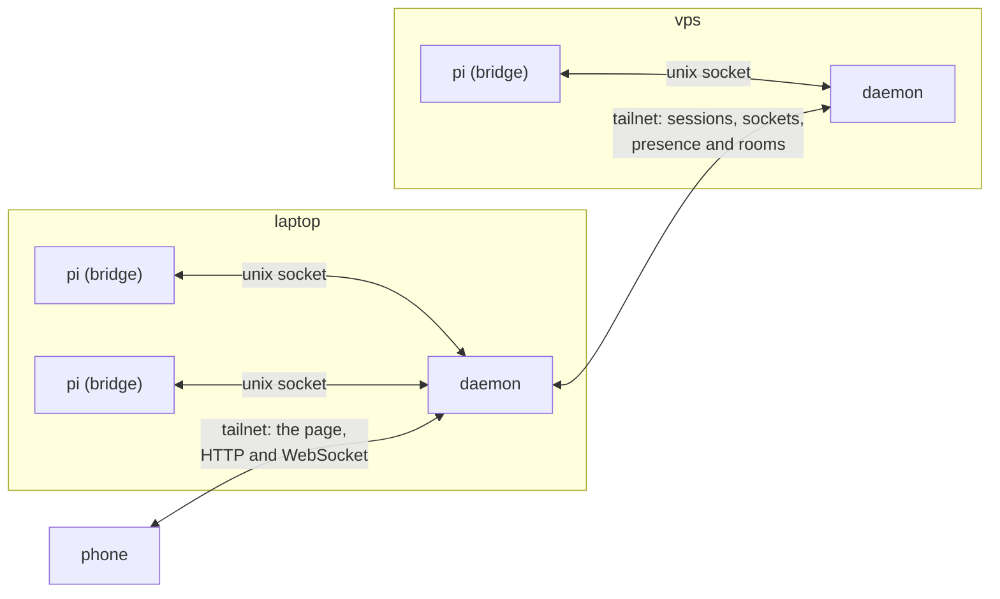

# Remote: your sessions from anywhere

Every pi session on every machine of yours, live in a browser from one address, with the questions,
the prompts and the controls the terminal has. And the agents on different machines talk to each
other, in the same rooms that join two terminals in one folder. The network is a Tailscale tailnet:
the machines find each other on it and trust each other because it says they are yours.

This document says how it works and why. The package READMEs have the details:
[`@adeildo/pi-remote`](../packages/remote/README.md) for the daemon, its routes and its security,
and [`@adeildo/pi-remote-protocol`](../packages/remote-protocol/README.md) for the wire.

## What it is for

The agent asks for a decision while I am away from the desk, and the run waits until I come back.
Most of what I need away from the desk is to answer that call, read what happened, and send the next
message. So:

1. I open `pi` in a terminal, on any of my machines, as I do today. My phone shows that session live,
   and I can answer its questions and steer it from there. Whichever side answers a question first
   wins, and the other side closes its dialog.
2. I open the same address on the phone whatever machine the session is on: the laptop, the desktop
   or a VPS. Nothing is paired or configured.
3. An agent on the laptop and an agent on the VPS talk in one room, as two agents in one folder do.

## The pieces

| Piece    | What it does                                                                                                                                                                                                     | Where it lives                                                                  |
| -------- | ---------------------------------------------------------------------------------------------------------------------------------------------------------------------------------------------------------------- | ------------------------------------------------------------------------------- |
| Bridge   | Runs inside every pi. Publishes the session's events and state, runs the commands a client sends, and enters the race for every dialog. Starts the daemon when none answers                                      | `@adeildo/pi-remote`, loaded by `@adeildo/pi-harness` like the other pieces     |
| Daemon   | One per machine. Keeps the live sessions and their state, a replay of recent events and the logins; serves the page; finds the owner's other machines, relays their sessions and copies their presence and rooms | `dist/daemon.js` of `@adeildo/pi-remote`, one file run by the Node that runs pi |
| Page     | The phone's screens: the sessions of every machine, and one session with its transcript, its question and its composer. A React app built by Vite, served by the daemon                                          | `packages/remote/web`                                                           |
| Protocol | The shapes on the wire, their decoders, and the reducer that rebuilds a session's state from its events. The client library the page uses. No Node, no pi                                                        | `@adeildo/pi-remote-protocol`                                                   |
| CLI      | `pi-remote open` and `pi-remote serve`                                                                                                                                                                           | `dist/cli.js` of `@adeildo/pi-remote`                                           |

The daemon and the CLI run outside pi's extension loader, which is what compiles an extension's
TypeScript, so the package ships them built: one file each, with `ws` inside and nothing but Node's own
modules outside, because pi installs packages without their peers. A launcher in the remote's folder
always points at the pi that started last, so an update needs no new service. A daemon exits five
minutes after its last session, and makes way when a newer one is installed.

## Reaching it

- **On the machine.** The daemon listens on `127.0.0.1:7878`. `/remote` in pi prints a link with a
  token in its fragment, good once for a minute, which the page trades for a login cookie. The login
  applies on loopback too, because every user of a machine reaches its loopback.
- **On the tailnet.** On a machine in a Tailscale tailnet, the daemon also listens on its tailnet
  address, at the same port. A device of the machine's owner opens it with no link: the daemon asks
  `tailscale whois` who the device belongs to, and the owner's device gets its login with the first
  page. A node another user shares into the tailnet needs a link like any other. A machine that joins
  its tailnet after the daemon started gets a daemon that listens there within fifteen seconds.
- **Without Tailscale,** an SSH tunnel (`ssh -L 7878:127.0.0.1:7878`) works, with a link.

## Machines

A machine is a computer of yours on the tailnet whose daemon answers at the same port.

- **Finding.** Every fifteen seconds each daemon reads `tailscale status` for the owner's nodes that
  are online, and asks each one's daemon for its health, which names the machine. A `tailscale` that
  does not answer changes nothing; a machine whose daemon stops answering leaves at the next look.
- **Trust.** Nothing is paired and no key is exchanged. A daemon logs in at another the way the phone
  does, with no token, and the other daemon lets it in because its `whois` says the machine is its
  owner's. A machine that is not yours never gets in, whatever it runs.
- **One address.** The phone talks to one daemon. Its list holds the sessions of every machine; a
  session of another machine is read from that machine's daemon (`/sessions/<machine>/<id>/...`), and
  its socket is joined to that daemon's, byte for byte. A daemon asks another for its own sessions
  only, so two daemons never ask each other in a circle.
- **The Machines page** (`/machines`) lists them from `/tailnet`: this machine first, then each other
  one with its harness version and how long its remote has been up. A machine that stops answering
  stays, dimmed, with when it last answered, until this daemon restarts.
- **Where a session runs** never changes: it runs where its pi was started, and every machine shows it
  under that machine's name.

## Rooms across machines

The rooms of [peers](../packages/peers/README.md) are directories of logs, where each session writes
only its own file, and a session is in a room by its folder or by name. That is what lets them cross
machines with no merging:

- Every two seconds each daemon asks the others what they share: who is open there, and the size of
  every room log they hold. It writes the other machines' open sessions into this machine's presence
  index, and appends to each room log here what the other side has past this side's size. A log has
  one writer and only grows, so the longer copy is the newer one.
- In the presence index, a session of another machine is open while its daemon keeps writing it: an
  entry not written for fifteen seconds is a machine out of contact, and its sessions leave the rooms;
  what they wrote stays.
- So `Alt+G` lists the agents open on the other machines, a shared room can hold them, and a message
  reaches them the way it reaches an agent in the next terminal, with the same receipts.
- A folder's own room is not shared: the same path on two machines is two folders.

## A session's data

| Data                        | Nature                                                    | Cursor                                                     |
| --------------------------- | --------------------------------------------------------- | ---------------------------------------------------------- |
| The conversation            | pi's session file, a tree of entries                      | pi's entry id                                              |
| The harness's state changes | The session's harness log, append only                    | The byte offset                                            |
| Live state                  | The streamed message, the queue, open questions, the mode | `(epoch, seq)`: `seq` per bridge life, restarting with one |

Opening a session gives the **opening**: the summary, the tail of the active branch and the message
being written. Then the live stream follows from its `seq`, and older history comes in pages by entry
id, read by the daemon from pi's file. A client that reconnects says its cursor and gets what the
daemon still holds after it, or a new opening. At `turn_end` the bridge pairs each streamed message
with the entry pi wrote (`stream.bound`), so a reconnect never shows a message twice. The page keeps
what it read in `localStorage`, so a reload draws at once.

What the page sends while the daemon is out of reach waits in an outbox. After a reconnect, what was
typed in the last two minutes goes out by itself; anything older waits for the person to send, edit
or drop it, because "go ahead and push" from an hour ago is not the same instruction now. Every
command carries an id, and the bridge answers a repeat as a repeat.

## Questions and control

- **The harness's own dialogs**, the permission ask and `ask_questions`, go through the kit's ask
  client, and the bridge races the terminal against every client: the first answer wins, and the
  other side closes. pi's own `select`, `confirm` and `input` are raced the same way.
- **A `custom()` dialog** of another extension cannot be described as a question, so the page says the
  terminal waits on one, with its title.
- **No locks.** One person is never in two places, so the client with the latest input is the active
  one, and the daemon tells every client who has the session open.
- **What a client may not do:** grant an "always yes" that outlives the session, or change the
  remote's settings. It may set the mode to `full` after a confirm: a client that answers every
  approval already has that reach, and the confirm is there for a mis-tap.
- **The agent on the machine** runs as you, so it reaches the daemon's socket and port like you do. The
  permission feature always asks before a call that touches them, whatever the mode but `full`.

## Decisions

| Question                         | Decision                                                                   | Why                                                                                                                                                       |
| -------------------------------- | -------------------------------------------------------------------------- | --------------------------------------------------------------------------------------------------------------------------------------------------------- |
| Build it or use pi-mobile        | Build it on the kit's contracts                                            | pi-mobile forwards `select`, `confirm` and `input`; the harness's dialogs are `custom()` components it cannot forward, and it has no board, rooms or cost |
| Who runs the daemon              | One per machine, started by the first pi, gone five minutes after the last | Nothing to install or keep running                                                                                                                        |
| How machines trust each other    | Only through the tailnet: the owner's nodes, by `whois`                    | No pairing, no keys, no grants to keep. Tailscale already knows which machines are mine                                                                   |
| How the phone sees many machines | One address; the daemon relays the others                                  | One origin, one login, one page to add to the home screen                                                                                                 |
| How rooms cross machines         | Copying the logs, appended by size                                         | One writer per file and logs that only grow: nothing to merge, no clock to agree on                                                                       |
| The client                       | A web page, React with Vite, served by the daemon                          | No app store, no native build; any phone with a browser. A PWA or a wrapper can come later on the same page                                               |
| A session's name                 | The handle drawn when it opens, fixed; pi's `/name` gives the display name | `@` mentions reach a word that never moves, and pi already owns `/name`                                                                                   |
| Who holds the truth              | The machine that runs the session. Clients never sync with each other      | Every client converges on one place                                                                                                                       |

## Not built

- **Sessions with no terminal.** A runner that holds `pi --mode rpc` so a session outlives its terminal,
  and starting a session from the phone. Today a session lives as long as its pi.
- **Notifications.** A push when a session waits on you and no client is active.
- **HTTPS.** Through `tailscale serve`, which a PWA and push need. The tailnet's traffic is encrypted by
  WireGuard, so the daemon speaks plain HTTP on it.
- **Reach without Tailscale:** a Cloudflare tunnel or a reverse proxy, with a login of their own.
