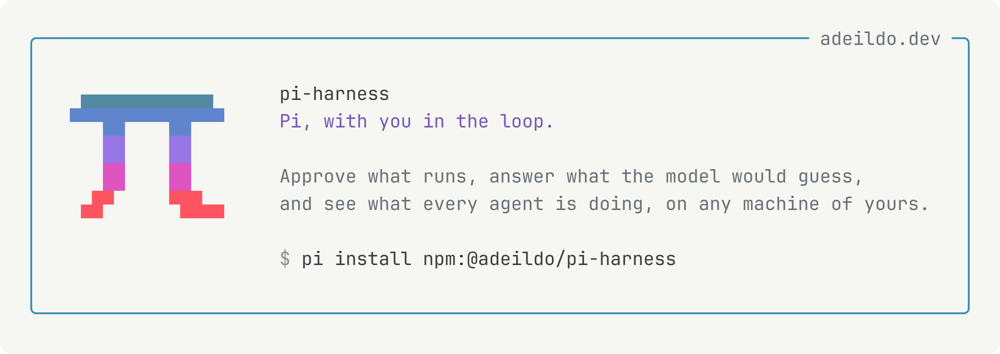
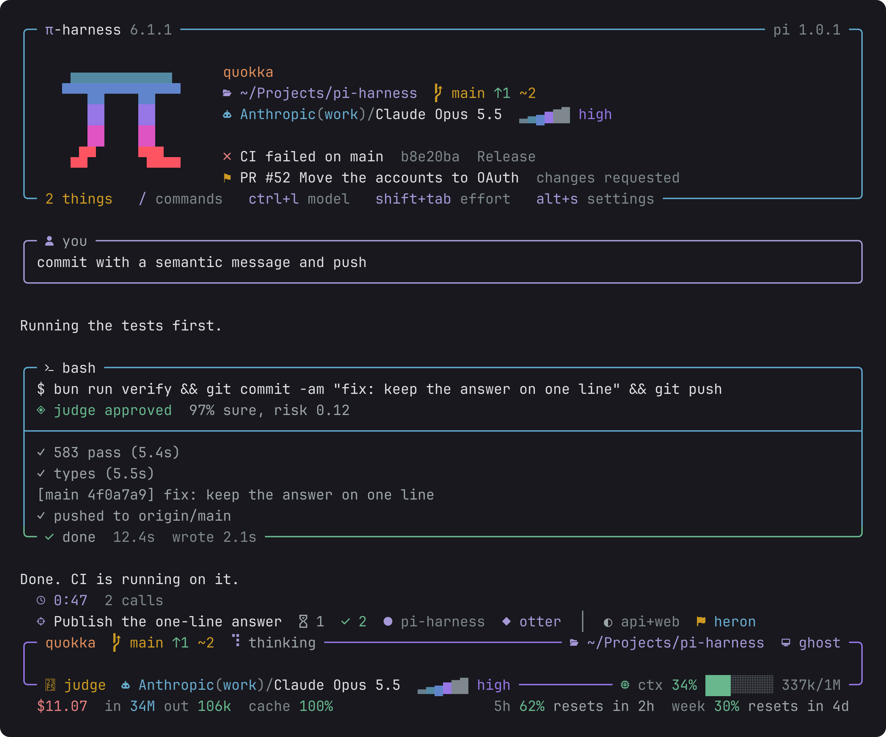

<!-- docs:banner -->

<p align="center">
  <picture>
    <source media="(prefers-color-scheme: dark)" srcset="https://raw.githubusercontent.com/felipeadeildo/pi-harness/main/assets/brand/banner-dark.png">
    
  </picture>
</p>

<!-- /docs -->

<p align="center">
  <a href="https://www.npmjs.com/package/@adeildo/pi-harness"></a>
  <a href="https://pi.dev"></a>
</p>

Every piece of [pi-harness](https://github.com/felipeadeildo/pi-harness) in one install. Pi asks you before it runs a command, the model asks you instead of guessing, and you see what every agent is doing, in the terminal and on your phone.

<p align="center"><code>pi install npm:@adeildo/pi-harness</code></p>

<!-- docs:harness/conversation -->

<p align="center">
  
  <br>
  <em>A session: the start card, what you asked, what the model ran, and what it cost.</em>
</p>

<!-- /docs -->

## What comes in it

| Piece                           | What it does                                                                                         |
| ------------------------------- | ---------------------------------------------------------------------------------------------------- |
| [Permission](../ask-permission) | Pi asks before it runs a command. A small model can answer the easy ones for you                     |
| [Questions](../ask-questions)   | The model asks instead of guessing, with options, a preview of each, and a note on any of them       |
| [Look](../look)                 | The start card, the editor with the branch and the model on its edges, and a box around each command |
| [Peers](../peers)               | Agents share rooms, see each other's work and talk                                                   |
| [Remote](../remote)             | Every session of every machine of yours, in a browser and on your phone                              |
| [Providers](../providers)       | Bills Anthropic requests to your Claude plan, and keeps several accounts per provider                |
| [Compact](../compact)           | Hides old tool output in long sessions, so each request costs less                                   |
| [Skill calls](../skills)        | You call your skills from anywhere in a message, several at once                                     |
| [Diagrams](../diagrams)         | Mermaid blocks drawn as pictures in your theme, while the model writes them                          |
| [Web](../web)                   | Search and fetch the web with Nico Bailon's pi-web-access, at a tested version and set up            |

All of them are on once the package is installed.

> [!WARNING]
> When a request uses an Anthropic OAuth token, Providers tells Anthropic that the request comes from Claude Code. Using a subscription outside Claude Code may break Anthropic's terms. If you do not want that, turn the `subscription` feature off as shown below. Requests that use an API key go out unchanged.

## Turning a piece off

Each piece is its own extension in this package, so `pi config` can turn off the ones you do not want, for every project or for one. The settings file also has a switch for each feature, and pi reads it on the next `/reload`:

```json
{ "features": { "subscription": { "enabled": false } } }
```

The feature ids are `permission`, `look`, `subscription`, `accounts`, `questions`, `skills`, `names`, `compact`, `peers`, `remote`, `web` and `diagrams`.

If you only want one piece, install its own package instead. When you install both, the copy that loads first runs the feature and the other one stays off.

## Settings

`Alt+S` opens the settings of every piece. They are stored in `~/.pi/agent/extensions/pi-harness/settings.json`, and each piece's page lists its own. A setting marked _project_ can also be set in `.pi/extensions/pi-harness/settings.json` inside a project that pi trusts, and the project's value wins.

<!-- docs:footer -->

<p align="center">
  <a href="https://adeildo.dev"></a><br>
  <a href="https://github.com/felipeadeildo/pi-harness">pi-harness</a> is made by <a href="https://adeildo.dev">adeildo.dev</a>
</p>

<!-- /docs -->
