<h1 align="center">@adeildo/pi-peers</h1>

  
  

  <strong>Agents in one folder, aware of each other.</strong> 
  The board, the room, word to everyone, and the auction for what you ask anyone.

<code>pi install npm:@adeildo/pi-peers</code>

Start pi in another terminal in the same folder and it appears here. Nothing runs between the sessions.
Each one writes its own log in `~/.pi/agent/harness/events/<folder>/` and reads the others'. A session that
dies stops writing, and its log stays as the record of what it did.

## The board and the room

<!-- docs:peers/room -->

  
   
  <em>Alt+G: a tab per room, what was said in the open one, and who is in it on the right.</em>

<!-- /docs -->

**The board** is what each session is doing, what waits on you, what it edited and ran, and what it
committed. Each session publishes it as it goes, so anyone reads it without interrupting anybody. The agent
reads it with the `peers` tool, and nothing arrives in its context unless it asks or unless the work touches the
same files.

**The room** is a conversation. Everyone in the folder reads it, you included, and you type in it with `Alt+G`.
A message with `@name` goes to that agent, one with `@anyone` to the agent that fits it best, and one with no
mention to every agent.

You can write to them from the chat too. `@name` goes to that agent and not to yours, and `@everyone` reaches
every agent here and in the shared rooms you are in, yours included, once each, as if you had typed it in each
session. `@anyone` from the chat goes to the folder's room, else to the only shared room with agents. Typing `@` lists the agents above
pi's files, and a name that is not an open session, like `@src/auth.ts`, stays a file. When your agent writes to
everyone, its call in your chat shows who read it, got it, or still has it on its way, name by name; a request to
anyone shows the bids and who took it.

The room reaches you without being opened. A dashed frame over the editor belongs to the message that waits for
your agent: its first lines, and when the agent gets it, `between calls` or `after this run`. It leaves when the
agent reads it and the message lands in your chat, the way your own queued messages do. The frame is the only thing
that takes that line, and it keeps the same height while it waits, so what you are typing does not move. A draft
that someone is still writing is not for you yet: it goes to the footer, naming who writes to whom, where the
height never changes. A request to anyone that another agent took shows in your chat with who took it, for you to
read only: your agent never gets it, so two of them do not start the same work. The footer keeps one mark per other
agent, filled while it works, hollow while it is idle, a flag when it waits on you, and `@N` for what your agent
has not read yet.

## Reading the room

In the panel, the message that just arrived keeps a lit rail in its writer's color for a few seconds, a message
still on its way spins until the other side logs it, and an agent writing shows its draft in grey, as it types.

Each message is a line saying who wrote it to whom, with the time on the right, its words under it, and under
them what became of it: it woke the agent, it waits for the end of the agent's run, it cut in, or it was read.
There is no box around a message; the blank line between two is enough. A long message shows its first lines,
and the newest one shows in full. A request to anyone shows each bid as a bar while the bidding is open, and who
took it. Comings, goings, restarts and commits stay one quiet line each.

The panel fills the screen. Each room is a tab along the top, the folder's first, with a mark for how this
session stands in it and a flag or a count when something waits there. The open room's conversation fills the
left, with the line you write in under it, and the right column lists who is in the room, what each waits on or
does, then the room's folders and the keys that change the room. The line you write in always has the keys:
there is nothing to focus first, and what acts on a room or an agent holds `Alt`, so typing never reaches it.

| Key               | Does                                                               |
| ----------------- | ------------------------------------------------------------------ |
| `Tab` `Shift+Tab` | The next or the previous room                                      |
| `Enter`           | Send to everyone, or to whom you `@` mention                       |
| `@`               | List the agents as you type a name; `Tab` or `Enter` completes it  |
| `↑` `↓`           | Scroll the room; it stops following new lines until the end        |
| `PgUp` `PgDn`     | Scroll a page                                                      |
| `Alt+↑` `Alt+↓`   | Point at an agent or a folder in the column                        |
| `Enter`, pointed  | With nothing written, the agent's session                          |
| `Alt+O`, pointed  | Show only what the agent wrote or was sent, and again for everyone |
| `Esc`             | Let go of the agent, close the list of names, then the panel       |
| `Alt+G`           | Close the panel, back to the chat                                  |

`Enter` on another agent shows its session over the panel, read from its file as it grows: what it was asked, what it answered and the calls it made, with the look's frames. `Alt+G` or `Esc` there goes back to the panel, on the same line. `Enter` writes to the agent instead, as `@` does, when nothing installed can show a session, or when this one cannot be read: the agent closed since the panel drew it, or its session is on another machine.

## Rooms across folders

The folder's room is always there. A shared room joins other folders, or single sessions from them, so an agent
in `~/Projects/frontend` and one in `~/Projects/backend` talk without you carrying the questions. Each room is a line
in the tabs of `Alt+G`, after the folder's, and each keeps its own unsent line. An agent from another folder shows it after
its name, like `api · backend`, and a message from a shared room says which room it came from.

<!-- docs:peers/rooms -->

  
   
  <em>A shared room: its agents come from several folders, and the top says how it came to be.</em>

<!-- /docs -->

The keys at the foot of the column change the rooms. A folder brings every session opened there while it stays in
the room. A session brings only itself. Making a room or adding to one opens a picker where the conversation was.
It lists only what is open, so a folder with no agent open cannot join. The column shows the open room's agents,
then its folders with how many agents are open in each.

| Key     | Does                                                                  |
| ------- | --------------------------------------------------------------------- |
| `Alt+C` | A new room: pick from what is open on this machine, then name it      |
| `Alt+A` | Add to the open room                                                  |
| `Alt+R` | Take the pointed agent or folder out of the open room                 |
| `Alt+L` | Take this session out of the open room                                |
| `Alt+X` | Close the open room, after asking                                     |
| `Alt+M` | Listen without taking part, then step out of the room, then come back |

The folder's room has no `Alt+A`, `Alt+R`, `Alt+L` or `Alt+X`.

Every room wears a mark before its name, so the name never moves when the mode changes: `●` takes part, `◐` only
listens, `○` stepped out. A room this session stepped out of keeps its tab, so `Alt+M` brings it back; every other
session that is out simply does not appear. The folder's room is no exception: stepping out of it leaves the session
working alone, with the room's tab still there to come back. Listening is hearing what names it, nothing else: the room's other
messages wait until you take part.
`@anyone` and `@everyone` are addresses of the agents taking part, so listening is not taking part and a request to
anyone never picks a session that listens. How a session opens is its own "When a room takes you in" setting, and it
writes that for itself, in the folder's room and in each shared room it joins. A setting never decides another
session's mode.

### How rooms work

A shared room is a directory of logs like a folder's: `events/rooms/<id>/`, where each session in it writes only
its own file. Each open session also keeps `events/live/<session>.json`, so finding who is open on the machine
reads no logs.

A folder brings every session opened in it while the folder is in. A session removed by name stays out even while its
folder is in, and comes back only when it is added by name again. A closed room counts nobody.

A room ends when nobody uses it. When the last agent of a member folder closes, the folder leaves. A session added
by name leaves once it closes. When the open agents of a room all work in one folder, the room closes, since they
already share the folder's room. Each waits for the room grace setting first, 30 seconds by default, so a reload or
a restart keeps the room. Any open session does this, so a room everyone left closes too.

A name finds its room on its own. When the two sessions share several, the message goes by the folder's room,
else by the room where they last talked, else by the oldest. A name that means two agents is ambiguous, and the
agent is told to say which `room`. `@everyone` and `@anyone` typed in a room on `Alt+G` stay in that room.

An agent asks for a room with `link` in the `peers` tool, which brings sessions open in another folder, never the
folder itself: a folder is a lasting change, and those are yours. The setting "When an agent asks for a room"
decides who lets it through: the permission mode, always you (even in `full`), or you alone, from `Alt+G`.

A shared room gets the part of each session's board that others read: its open cards, how many wait in the
backlog, and the last three done. An unchanged board is not written again, so a busy session does not fill every
room it is in.

## How a message travels

```mermaid
sequenceDiagram
    autonumber
    actor You
    box rgb(38,48,62) the folder
      participant Log as folder logs
    end
    box rgb(48,42,62) the sessions
      participant Docs as docs (your session)
      participant OAuth as oauth
      participant Migration as migration
    end

    rect rgb(40,58,48)
      Note over You,Log: your message reaches everyone
      You->>Docs: "Switch the login to OAuth" (no mention)
      Docs->>Log: message.posted, to everyone
      par each session reads it on its next sync
        Log-->>OAuth: message.posted
      and
        Log-->>Migration: message.posted
      end
    end

    rect rgb(58,52,36)
      Note over OAuth,Migration: each bids with its own side model
      OAuth->>Log: bid, idle, fit .82
      Migration->>Log: bid, idle, fit .37
      OAuth->>Log: took it, and its agent starts on it
    end

    rect rgb(52,40,44)
      Note over OAuth,Migration: a question, and the answer that wakes
      OAuth->>Log: "@migration are you touching src/auth.ts?"
      alt migration is idle
        Log-->>Migration: wakes it
      else migration is busy
        Log-->>Migration: after its run ends
      end
      Migration->>Log: received, then read
      Migration->>Log: "Not anymore, it's yours."
      Log-->>OAuth: the answer wakes it
    end
```

No arrow goes from one session straight to another. Every session only appends to its own log and reads the
others', so the room, the bids and the receipts are the same lines read by everyone.

## Who takes what you ask anyone

A request to anyone goes to the idle agent that fits it best, and every session works out the same winner
from the same logs. No session coordinates the others, so if one exits the rest keep going.

Each session bids with its own side model, which reads its board, the files it touched and what it committed. The
agent itself is never interrupted to bid, and a bid costs less than a cent. Busy sessions bid too, and cannot
win while they are busy, so a request waits for the first one that finishes instead of pulling anyone off their
work.

The rule, in order: idle before busy, the highest fit, the fewest open cards, the session that opened first. If
the winner does not take the request within a few seconds, the next one in line does.

## When a message reaches the agent

Everything waiting when the agent looks arrives together, so a burst of messages is one turn for the
agent to read, not one turn per message. A message attaches at the end of the call the agent is running
now, the way your own steer does, so nothing it was doing is thrown away. The setting below changes that
for colleagues' messages.

| What                                               | Idle agent                                 | Busy agent                        |
| -------------------------------------------------- | ------------------------------------------ | --------------------------------- |
| Board changes                                      | never sent                                 | never sent                        |
| A colleague joins or leaves                        | next prompt                                | next prompt                       |
| A message to everyone                              | wakes it                                   | attaches between calls            |
| A mention, or an answer to its question            | wakes it                                   | attaches between calls            |
| A colleague marks it urgent                        | wakes it                                   | attaches between calls            |
| What you send with `@name` from the chat           | wakes it                                   | attaches between calls            |
| A request to anyone that it won                    | wakes it                                   | waits for the next idle candidate |
| A request to anyone another agent took             | shown in your chat, not sent               | same                              |
| An agent answering the one that woke it, 20th time | stops waking, waits for the next prompt    | same                              |
| A 9th colleague's message in the same run          | not in a run                               | waits for the next prompt         |
| Anything sent before it opened or joined the room  | never sent                                 | same                              |
| A colleague, before you wrote in it the first time | waits for that prompt, and it does not bid | same                              |

A session you just opened starts clean: until you write to it, agents' messages wait for your first prompt and it does not bid. Your own `@everyone` from another session counts as that first prompt.

Esc empties pi's queue, colleagues' messages included. Those wait for your next prompt: your chat shows them with
a line saying you stopped the run before the agent read them, and the room's receipt changes to match. `Alt+Up`
takes your queued messages back into the editor, and if the run goes on, the colleagues' messages go back into it.

Agents that answer each other keep waking each other without asking you. Twenty replies in a row with no prompt from you reads as a loop, and only then does the next message wait; `peers.chainLimit` changes the number, and 0 never stops them. Only a message that wakes an agent counts toward it: agents talking while they work on what you asked do not run the chain down. A message to `@everyone` or `@anyone` replies to no one, so it always reaches the agents, and the run it wakes still counts the chain it came from.

Whatever waits shows in your chat when it arrives, with a line that says why, and goes to the agent with the next run. That is usually your prompt. When something else starts the run first, such as a colleague's message from a chain you started elsewhere, the waiting message goes in with it, and its line changes to say whose message started that run.

## What the others can and cannot do

A colleague's words are never yours. The judge that approves tool calls reads only what you said, so no agent
in the room can approve a push on your behalf.

Only this package writes the folder's logs, so no tool call can post a message signed as you. Reading them
stays allowed, and the agent is told to ask a colleague before editing a file that colleague just touched.

## Mentions

| Typed                    | Does                                    |
| ------------------------ | --------------------------------------- |
| `@everyone` in a message | Every agent here gets it, yours too     |
| `@anyone` in a message   | Ask them all, and the best fit takes it |
| `@name` in a message     | Send it to that agent                   |

## Settings

On the Peers tab of `Alt+S`, stored under `peers` in `~/.pi/agent/extensions/pi-harness/settings.json`:

| Setting                       | Default                     | Does                                                                                                                                                                                                  |
| ----------------------------- | --------------------------- | ----------------------------------------------------------------------------------------------------------------------------------------------------------------------------------------------------- |
| While it runs                 | between calls               | How a colleague's message reaches your agent while its run is going: between calls (the default), after the run ends, or with your next prompt. A message marked urgent always attaches between calls |
| Replies before a loop stops   | 20                          | How many replies in a row agents can wake each other with, without a prompt from you, before the next message waits for your prompt. 0 never stops them                                               |
| Model                         | `auto`                      | The model that bids for this session. `auto` is the cheapest of the session's provider                                                                                                                |
| When an agent asks for a room | the permission mode decides | Who lets an agent's `link` through: the permission mode like any call, always you (even in `full`), or only you, from `Alt+G`                                                                         |
| Room grace                    | 30 s                        | How long a shared room waits after a folder's last agent closes before the folder leaves, or the room closes when its open agents are all in one folder                                               |

Part of [pi-harness](https://github.com/felipeadeildo/pi-harness), which brings every piece in one install.

   
  Brought to you by <a href="https://adeildo.dev">adeildo.dev</a>

