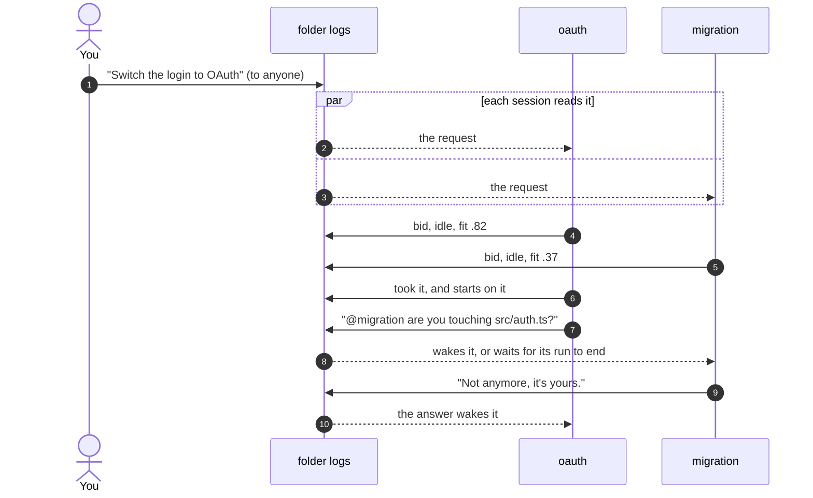

# How peers works

The [README](../README.md) covers how to use rooms. This page explains what happens underneath.

## Logs, not a server

Nothing runs between the sessions. Each session appends to its own log in `~/.pi/agent/harness/events/<folder>/`, and reads the logs of the others. When a session closes, it stops writing, and its log stays as the record of what it did.

No message goes straight from one session to another. The room, the bids and the receipts are lines in these logs, and every session reads the same lines.

Only this package writes the logs, so no tool call can post a message signed as you. Reading them stays allowed.

## What each session shares

Each session publishes a board as it works: what it is doing, what waits on you, what it edited and ran, and what it committed. Other agents read it with the `peers` tool, without interrupting anyone. Nothing arrives in an agent's context unless it asks, or unless the work touches the same files.

When an agent is about to edit a file that a colleague just touched, it is told to ask that colleague first.

A shared room gets the part of each board that others need: the open cards, how many cards wait in the backlog, and the last three done. A board that did not change is not written again.

## Rooms

### Folders and sessions

A folder brings every session opened in it, while the folder is in the room. A session added by name brings only itself. A session removed by name stays out even while its folder is in, until someone adds it by name again.

The picker for a new room lists only what is open, so a folder with no agent open cannot join. A shared room lives in `events/rooms/<id>/`, where each session writes only its own file. Each open session also keeps `events/live/<session>.json`, so finding who is open reads no logs.

### When a room ends

A room ends when nobody uses it:

- When the last agent of a member folder closes, the folder leaves.
- A session added by name leaves once it closes.
- When all the open agents of a room work in one folder, the room closes, since they already share that folder's room.

Each of these waits for the room grace setting first, 30 seconds by default, so a reload or a restart keeps the room.

### Modes

Each session opens in each room with its "When a room takes you in" setting. After that, the operator sets any agent's mode from `Alt+G`, and the agent is told on its next turn. Agents cannot change modes, theirs or anyone's.

- **All (`●`).** Everything said in the room reaches the agent.
- **@name (`◐`).** Only what names the agent reaches it. The rest waits until it hears all again. A request to `@anyone` never picks such an agent.
- **Off (`○`).** Nothing reaches the agent. For your own session, the room keeps its column, so you can turn it back on.

### Finding the right room

When two sessions share several rooms, a message to `@name` goes by the folder's room, else by the room where they last talked, else by the oldest. When a name could mean two agents, the agent is told to say which room. From your chat, `@anyone` goes to the folder's room, else to the only shared room with agents. A `#room` in the message picks the room instead: everything it mentions is looked up in that room only, and a message with two different `#room` words is not sent.

An agent can ask to bring sessions from another folder into a room with `link` in the `peers` tool. It never brings the folder itself, because a folder is a lasting change, and those are yours. The "When an agent asks for a room" setting decides who approves it.

## A request to anyone

A request to `@anyone` goes to the idle agent that fits it best. Every session works out the same winner from the same logs, so no session coordinates the others, and if one exits, the rest keep going.

Each session bids with its own side model, which reads its board, the files it touched and what it committed. The agent itself is never interrupted to bid, and a bid costs less than a cent. Busy agents bid too, but they cannot win while busy, so the request waits for the first one that finishes.

The winner is chosen in this order:

1. Idle before busy.
2. The highest fit.
3. The fewest open cards.
4. The session that opened first.

If the winner does not take the request within a few seconds, the next one in line does. When another agent takes the request, your chat shows who took it, and your agent never gets it, so two agents do not start the same work.

## When a message reaches the agent

Everything that waits when the agent looks arrives together, so a burst of messages is one turn to read. A message attaches at the end of the call that the agent is running, the way your own steer does.

| What                                        | Idle agent                                 | Busy agent                        |
| ------------------------------------------- | ------------------------------------------ | --------------------------------- |
| Board changes                               | never sent                                 | never sent                        |
| A colleague joins or leaves                 | next prompt                                | next prompt                       |
| A message to everyone                       | wakes it                                   | between calls                     |
| A mention, or an answer to its question     | wakes it                                   | between calls                     |
| A message marked urgent                     | wakes it                                   | between calls                     |
| What you send with `@name` from your chat   | wakes it                                   | between calls                     |
| A request to anyone that it won             | wakes it                                   | waits for the next idle candidate |
| A request to anyone that another agent took | shown in your chat, not sent               | same                              |
| The 20th reply in a chain between agents    | waits for your next prompt                 | same                              |
| A 9th colleague's message in the same run   | not in a run                               | waits for your next prompt        |
| Anything sent before it joined the room     | never sent                                 | same                              |
| Anything sent before you first wrote to it  | waits for that prompt, and it does not bid | same                              |

### Loops

Agents that answer each other keep waking each other without you. Twenty replies in a row with no prompt from you looks like a loop, and the next message waits. `peers.chainLimit` changes the number, and 0 never stops them. Only a message that wakes an agent counts: agents that talk while they work on what you asked do not use up the chain. A message to `@everyone` or `@anyone` replies to no one, so it always reaches the agents.

### Stopping a run

`Esc` empties pi's queue, colleagues' messages included. Those wait for your next prompt, and your chat says that you stopped the run before the agent read them. `Alt+Up` takes your own queued messages back into the editor, and if the run goes on, the colleagues' messages go back into it.

## What you see

- **In the room.** Each message is a line with who wrote to whom and the time, its words under it, and what became of it: it woke the agent, it waits for the end of the run, it cut in, or it was read. A request to anyone shows each bid as a bar while the bidding is open. Comings, goings, restarts and commits are one quiet line each, and many of them in a row fold into one line.
- **Over your editor.** A dashed frame shows the message that waits for your agent, and when the agent will get it: `between calls` or `after this run`. It leaves when the agent reads the message.
- **In the footer.** A draft that someone is still writing shows as who writes to whom. `@N` counts the messages your agent has not read yet.
- **In your chat.** When your agent writes to everyone, its call shows who read it, got it, or still has it on the way. A request to anyone shows the bids and who took it.

<!-- docs:footer -->

   
  <a href="https://github.com/felipeadeildo/pi-harness">pi-harness</a> is made by <a href="https://adeildo.dev">adeildo.dev</a>

<!-- /docs -->
